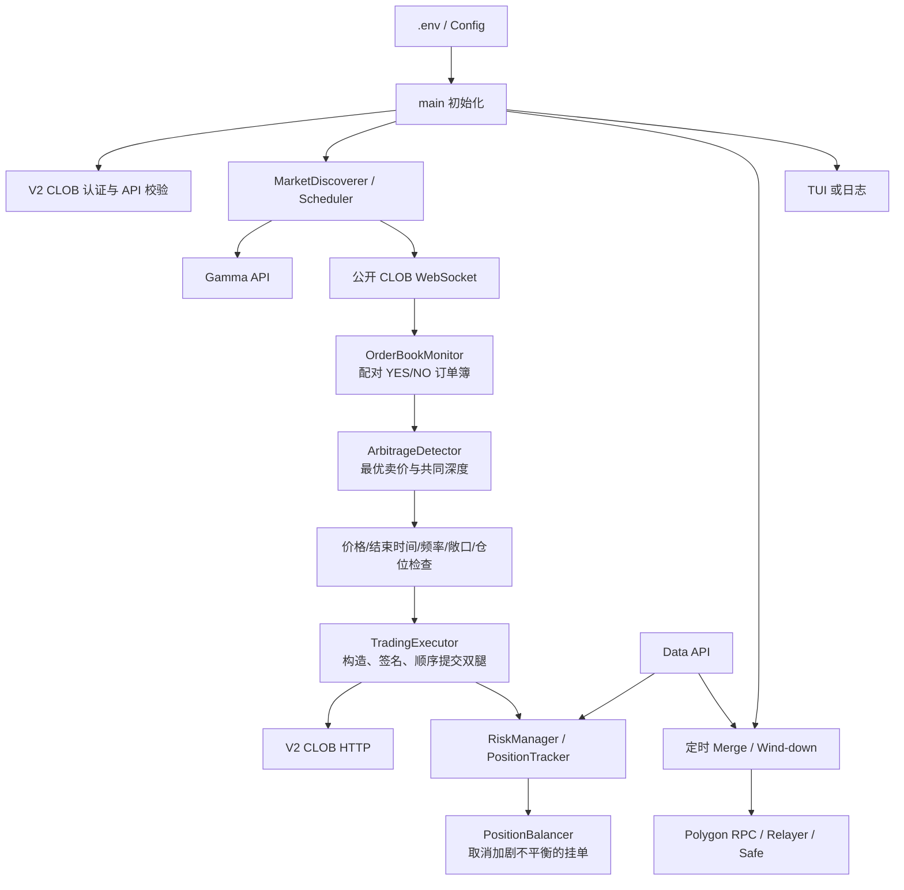

# Polypulse 项目代码结构与逻辑分析

> 分析基线：仓库 `dev` 分支，提交 `0081cb6`；分析日期：2026-08-13。
>
> 本文依据当前源码描述实际行为。README 中的产品说明代表设计目标，但“已接入主流程”和“仅保留代码”在本文中会明确区分。
>
> 后续优化已实施。本文保留为优化前基线，最新变更与验证结果见 [`OPTIMIZATION_RESULT.zh-CN.md`](./OPTIMIZATION_RESULT.zh-CN.md)。

## 1. 项目总体目标

Polypulse 是一个面向 Polymarket 加密货币 **Up/Down 5 分钟二元预测市场**的 Rust 自动交易程序。它试图捕获同一市场两种互补结果代币的组合定价偏差：

```text
YES 最优卖价 + NO 最优卖价 < 1
```

同一条件下等量持有 YES 和 NO，理论上可以合并（Merge）回 1 单位抵押资产。因此，当两腿总买入成本低于 1 时，价差构成毛套利空间：

```text
单份毛利润 = 1 - YES 买入价 - NO 买入价
总毛利润   = 单份毛利润 × 两腿共同成交数量
```

当前程序的总体职责包括：

1. 按 UTC 5 分钟边界发现 BTC、ETH 等 Up/Down 市场。
2. 通过公开 WebSocket 同时维护 YES/NO 订单簿。
3. 在组合卖价满足阈值、价格过滤、时限和风险检查时构造双腿买单。
4. 通过已认证的 Polymarket V2 CLOB 客户端签名并提交订单。
5. 周期性同步仓位、检测仓位与挂单不平衡，并取消可能加剧失衡的订单。
6. 可选地把等量 YES/NO 在 Polygon 链上 Merge 为 pUSD 或 USDC.e。
7. 可选地在窗口结束前取消挂单、Merge 配对仓位，并低价卖出剩余仓位。
8. 通过终端仪表盘或结构化日志展示运行状态。

它不是“完全无风险”的原子套利器。当前双腿订单是顺序提交的，成交、滑点、延迟和单腿暴露均可能使实际结果偏离上述理论关系。

## 2. 技术栈与外部系统

项目是 Rust 2021 单包工程，包名和默认二进制名均为 `polypulse`。核心依赖与用途如下：

| 依赖/系统 | 用途 |
|---|---|
| `tokio`、`futures` | 异步任务、定时器、WebSocket 流和主事件循环 |
| `polymarket-client-sdk` | Gamma 市场发现、公开订单簿 WebSocket、Data API、CTF 辅助计算 |
| `polymarket_client_sdk_v2` | V2 CLOB 认证、订单构造、签名、提交、查询和撤单 |
| `alloy` | Polygon RPC、合约调用、EIP-712/交易签名、Safe 执行 |
| `rust_decimal` | 价格、数量、成本和仓位的十进制定点计算 |
| `dashmap` | 跨异步任务共享订单簿、仓位、敞口和订单对状态 |
| `ratatui`、`crossterm` | 全屏终端仪表盘 |
| Gamma API | 根据 slug 获取市场元数据和 token ID |
| CLOB HTTP/WebSocket | 行情订阅、认证交易、订单查询与撤单 |
| Data API | 查询资金地址当前持仓 |
| Polygon RPC | ERC-1155/ERC-20 余额、CTF Merge、Safe 调用和链上校验 |
| Polymarket Relayer | Deposit Wallet / legacy Proxy 的链上批量调用 |

项目同时依赖两代 SDK：旧 SDK 承担行情、Gamma、Data 和 CTF，新 SDK 主要承担 V2 CLOB 交易。这也导致部分 `Address`、`U256` 类型需要通过字符串转换在两个 SDK 类型体系间桥接。

## 3. 顶层目录结构

```text
Polymarket-5min-bot/
├── Cargo.toml                 # 包信息与依赖
├── .env.example               # 完整运行参数模板
├── README.md                  # 英文使用说明
├── README.zh-CN.md            # 中文使用说明
├── image/                     # README 截图
├── docs/
│   └── CODEBASE_ANALYSIS.zh-CN.md
└── src/
    ├── main.rs                # 二进制入口、任务编排和完整交易主循环
    ├── lib.rs                 # 链上能力、CLOB 工厂、持仓与 UI 的库入口
    ├── config.rs              # 环境变量解析
    ├── market/                # 5 分钟市场发现和窗口调度
    ├── monitor/               # 订单簿缓存与套利机会计算
    ├── trading/               # V2 CLOB 下单执行
    ├── risk/                  # 仓位、敞口、订单平衡和恢复策略
    ├── ui/                    # TUI 状态、事件循环和渲染
    ├── positions.rs           # Data API 持仓查询
    ├── merge.rs               # YES/NO 链上合并
    ├── redeem.rs              # 结算后胜出代币赎回（未接主流程）
    ├── pusd_wrap.rs           # USDC.e → pUSD 包装
    ├── adapter_auth.rs        # CTF Adapter 授权与交易确认
    ├── proxy_relay.rs         # legacy Proxy / Builder Relayer 基础设施
    ├── deposit_wallet_relay.rs# Poly1271 Deposit Wallet 批量调用
    ├── wallet_kind.rs         # 链上钱包路由分类
    └── utils/                 # 日志初始化与套利记录辅助代码
```

### 3.1 二进制与库的边界

`main.rs` 自己声明了 `config`、`market`、`monitor`、`risk`、`trading`、`utils`，作为二进制内部模块；同时通过包库名 `polypulse` 使用 `merge`、`positions` 和 `ui`。`lib.rs` 则导出链上操作、持仓、UI 和 V2 CLOB 客户端。

因此当前工程存在两个模块入口：

- **二进制侧**：业务编排、行情、策略、交易和风控。
- **库侧**：可复用的账户认证、持仓查询、链上资产处理和 UI。

`src/trading/clob_client.rs` 只是对 `polypulse::clob_v2` 的再导出；`trading/orders.rs` 和 `utils/errors.rs` 当前为空壳。这个布局可运行，但模块所有权不够统一，后续维护时容易误判某段代码属于二进制还是库。

## 4. 总体架构与数据流



系统没有数据库。短期状态保存在内存 `DashMap` 或 `Mutex` 中；真实仓位通过 Data API 周期性覆盖本地仓位缓存；链上动作完成后再用余额变化进行校验。

## 5. 启动和主循环逻辑

### 5.1 启动阶段

`main()` 的启动顺序是：

1. 安装 rustls `ring` 加密提供者，避免后续 TLS 客户端初始化失败。
2. 根据 `TUI_ENABLED`、`PLAIN_LOGS` 和 stdout 是否为终端决定启用 TUI 还是普通日志。
3. 从 `.env`/进程环境读取 `Config`。
4. 校验私钥能否解析为 Polygon 本地签名器。
5. 按 `SIGNATURE_TYPE` 和资金地址创建 V2 CLOB 已认证客户端。
6. 调用 `api_keys()` 做一次真实认证可用性验证，失败则退出。
7. 创建交易执行器、风险管理器、仓位平衡器和仪表盘状态。
8. 按配置启动持仓同步任务和定时 Merge 任务。
9. 进入永久的 5 分钟窗口循环。

### 5.2 每个 5 分钟窗口

每轮执行以下流程：

1. 立即查询当前窗口市场；若尚未生成，每 2 秒重试，最多约 90 秒，之后等待下一窗口。
2. 清空“本轮敞口成本”和仪表盘窗口数据。
3. 为所有有效市场登记 YES/NO token，创建一次公开订单簿订阅流。
4. 建立 `condition_id → MarketInfo` 和 `condition_id → (YES token, NO token)` 映射。
5. 在 `tokio::select!` 中同时处理：
   - WebSocket 订单簿更新；
   - 仓位/挂单平衡定时器；
   - 每秒一次的窗口切换和 UI 状态更新。
6. 检测到 UTC 窗口时间戳变化后丢弃旧流、清空订阅缓存并开始下一轮。

### 5.3 单次行情更新到下单

当任一 token 的完整订单簿更新到达时：

1. `OrderBookMonitor` 更新 token 订单簿缓存。
2. 如果同一 `condition_id` 的另一腿已有缓存，组合成 `OrderBookPair`。
3. 读取两腿最优卖价。代码依赖 SDK 返回的 asks 顺序，使用 `asks.last()` 作为最低卖价。
4. 计算 `total = yes_ask + no_ask`；`total < 1` 仅用于展示，真正执行条件是：

   ```text
   total <= 1 - ARBITRAGE_EXECUTION_SPREAD
   ```

5. `ArbitrageDetector` 把价格四舍五入到 2 位，取两腿最优档可用量的较小值，并向下截断到 2 位；两腿名义金额都必须至少约 1 美元。
6. 主循环依次检查 YES/NO 最低价格、距离结束时间、最大敞口、本地持仓失衡和全局 3 秒最短交易间隔。
7. 在本地先记入两腿预期成本，然后 `tokio::spawn` 异步执行订单，避免阻塞行情消费。
8. 执行器并行构造、并行签名两腿订单，但按调整后价格较高的一腿优先，**顺序调用**两次 `post_order`。
9. 执行结果注册到 `RiskManager`，并把 API 返回的 `taking_amount` 计入本地仓位。

## 6. 各模块功能

### 6.1 `config.rs`：配置中心

`Config::from_env()` 负责读取私钥、资金地址、CLOB、市场列表、套利阈值、滑点、订单类型、风控、同步、Merge 和收尾参数。除私钥外，大多数解析失败会静默退回默认值。

需要注意：

- `POLYMARKET_PROXY_ADDRESS` 解析失败会变成 `None`，不会立即报告地址格式错误。
- `SIGNATURE_TYPE` 默认 `Poly1271`；非 EOA 签名类型必须有 funder 地址。
- `.env.example` 的示例值与代码默认值并不完全相同，例如示例只监控 `btc,eth` 且套利 spread 为 `0.03`，代码默认监控四种币且 spread 为 `0.01`。
- `MAX_ORDER_SIZE_USDC` 在实际执行中被当作 **share 数量上限**，不是严格的美元成本上限。

### 6.2 `market/`：市场发现与窗口调度

`MarketDiscoverer` 将当前 UTC 时间向下对齐到 300 秒，生成类似 `btc-updown-5m-{timestamp}` 的 slug，并批量查询 Gamma API。只接受：

- `active = true`；
- 已启用订单簿；
- 正在接受订单；
- outcomes 恰好包含 `Up`、`Down`；
- 恰好有两个 CLOB token ID。

解析后把第一个 token 当作 YES/Up，第二个当作 NO/Down。`MarketScheduler` 负责当前窗口重试和下一窗口等待。

### 6.3 `monitor/`：行情缓存与套利检测

`OrderBookMonitor` 使用无需认证的 CLOB WebSocket，按 token ID 缓存最近一次完整订单簿。任一腿更新后，只要另一腿已有快照就向上游返回配对结果。

`ArbitrageDetector` 当前只检查最优一档，虽然结构中有 `max_depth = 10`，但没有实际跨档聚合。它计算共同数量、组合成本和理论利润率，并要求两腿各自名义金额达到最小值。

重要现状：构造器接收的 `MIN_PROFIT_THRESHOLD` 被保存，但检测函数没有使用该字段；实际触发利润门槛完全由 `ARBITRAGE_EXECUTION_SPREAD` 控制。

### 6.4 `trading/` 与 `clob_v2.rs`：认证和订单执行

`clob_v2.rs` 负责：

- 将字符串映射为 `Eoa`、`Proxy`、`GnosisSafe` 或 `Poly1271`；
- 配置服务器时间并完成 CLOB 认证；
- 把旧 SDK 的地址转换到新 SDK 类型。

`TradingExecutor` 负责认证验证、全撤单、收尾卖单和双腿套利订单：

- 支持 GTC、GTD、FOK、FAK；
- GTD 会附加绝对过期时间；
- 根据上一跳价格方向选择两组滑点之一；
- 调整价格最大限制为 1，但没有限制最小值；
- 两腿构造和签名并行，HTTP 提交顺序执行；
- 以响应的 `taking_amount` 判断即时成交量。

只要代码走到正常响应返回路径，`OrderPairResult.success` 就固定为 `true`，包括只成交一腿的情形；因此它更接近“请求已获得响应”，不是“套利双腿成功”。

### 6.5 `risk/`：本地风险状态与挂单平衡

`PositionTracker` 保存两类数据：

- `positions`：token 当前 share 数量，由成交结果增量更新，也会被 Data API 定时全量覆盖；
- `exposure_costs`：按 token 记录本轮预记买入成本，用于最大敞口限制。

`RiskManager` 保存订单对及状态：双腿全成、双腿部分成交、单腿成交或双腿失败。它会把实际 `taking_amount` 加入本地仓位。

`RecoveryStrategy` 和 `HedgeMonitor` 包含止盈/止损、单腿退出等较完整的代码框架，但主程序明确关闭了 hedge 策略：部分成交和单腿成交最终都返回 `RecoveryAction::None`，`HedgeMonitor` 仅被构造，没有接收订单簿或执行检查。

`PositionBalancer` 周期性读取所有活动买单和 Data API 仓位，按当前窗口市场分组。当实际仓位或“仓位 + 待成交挂单”差异超过阈值时，它取消会加剧失衡的挂单。它不会主动补齐缺少的一腿，也不会直接卖出已有超额仓位。

### 6.6 `positions.rs`：持仓查询

该模块从环境变量读取 `POLYMARKET_PROXY_ADDRESS`，用 Data API 查询该资金地址的持仓。即使交易签名类型是 EOA，持仓查询仍硬性依赖这个环境变量；因此“EOA 无需 proxy address”只适用于 CLOB 认证，启用持仓同步、Merge 或收尾时仍会遇到该依赖。

### 6.7 `merge.rs`、`pusd_wrap.rs`、钱包与 Relayer 模块

Merge 主流程是：

1. 通过 Data API 找出同时存在 YES 和 NO 正持仓且 `mergeable` 的 condition。
2. 依据 API token 提示或 CTF position ID 计算，分别探测 pUSD 与 USDC.e 抵押的链上 ERC-1155 余额。
3. 取 `min(YES balance, NO balance)` 作为最大合并量。
4. 根据钱包类型选择执行通道：
   - `Poly1271` Deposit Wallet：Relayer `WALLET` batch；
   - legacy Magic Proxy：Relayer `PROXY` 调用；
   - Gnosis Safe：构造并执行 `execTransaction`。
5. 必要时先为 Collateral Adapter 设置 ERC-1155 授权。
6. 等待交易确认，并以 YES/NO 链上余额实际下降验证成功。
7. 如果原仓位以 USDC.e 抵押且目标是 pUSD，可继续 approve 并通过 Collateral Onramp wrap。

`proxy_relay.rs` 负责 Builder HMAC 鉴权、Proxy 地址推导、Relayer 请求和 Safe ABI；`deposit_wallet_relay.rs` 负责 Deposit Wallet 的 EIP-712 Batch 签名；`wallet_kind.rs` 用 `SIGNATURE_TYPE` 优先判断 Deposit Wallet，否则根据合约代码长度粗分 legacy Proxy 与 Safe；`adapter_auth.rs` 负责授权检测与 Relayer 交易等待。

定时 Merge 在启动 10 秒后运行，每轮逐市场串行处理，市场间等待 30 秒；RPC rate limit 错误会等待 12 秒后重试一次。收尾 Merge 同样逐市场串行执行。

### 6.8 `redeem.rs`：结算赎回

该模块支持普通/NegRisk condition、pUSD/USDC.e 输出、Deposit Wallet、legacy Proxy 和 Safe，并可验证 outcome token 余额下降。但当前 `main.rs` 没有调用 `redeem_one()`，所以机器人不会自动赎回已结算的胜出单腿仓位。

### 6.9 `ui/` 与 `utils/`：可观测性

TUI 默认在交互式终端开启，可通过键盘退出并设置共享 `shutdown` 标志。它展示窗口倒计时、市场价格、机会、交易尝试/结果、PnL、风险敞口和事件流。非 TUI 模式使用 stdout 日志；TUI 模式默认把日志写入 `bot.log`。

`utils/arbitrage_logger.rs` 可以把机会以 JSON 片段追加到文件，但当前主循环没有调用它。`trading/orders.rs`、`trading/clob_client.rs` 和 `utils/errors.rs` 中前两者分别为空壳/再导出，未形成独立业务层。

## 7. 并发与状态模型

当前进程内主要存在以下并发单元：

| 单元 | 生命周期 | 共享状态/副作用 |
|---|---|---|
| 主窗口循环 | 进程全程 | 行情流、市场映射、交易触发、窗口切换 |
| 持仓同步任务 | 配置开启后永久运行 | 全量覆盖 `PositionTracker.positions` |
| 定时 Merge 任务 | 配置开启后永久运行 | 链上资产、持仓与敞口扣减 |
| 每次套利执行任务 | 每次机会触发 | CLOB 订单、本地仓位、仪表盘 |
| Wind-down 任务 | 每个窗口最多启动一次 | 全撤单、链上 Merge、剩余持仓卖单 |
| TUI 线程 | TUI 开启时 | 读取/更新 `DashboardState`，设置 shutdown |

关键共享对象通过 `Arc`、`DashMap`、`AtomicBool` 和 `Mutex` 协调。`wind_down_in_progress` 只用于阻止定时 Merge 与收尾 Merge 重叠，不会阻止主循环继续产生套利订单；停止临近结束交易依赖另一个配置 `STOP_ARBITRAGE_BEFORE_END_MINUTES`。

## 8. 配置分组与作用

| 分组 | 关键变量 | 实际用途 |
|---|---|---|
| 账户 | `POLYMARKET_PRIVATE_KEY`、`POLYMARKET_PROXY_ADDRESS`、`SIGNATURE_TYPE` | CLOB 签名、funder、Data API 与链上钱包 |
| Builder/链上 | `POLY_BUILDER_*`、`RELAYER_URL`、`MERGE_OUTPUT_TOKEN`、`MERGE_WRAP_TO_PUSD` | Relayer 鉴权及 Merge/Redeem 输出 |
| 市场 | `CRYPTO_SYMBOLS`、`MARKET_REFRESH_ADVANCE_SECS` | slug 生成与窗口提前查询 |
| 套利 | `ARBITRAGE_EXECUTION_SPREAD`、`MIN_*_PRICE_THRESHOLD`、`SLIPPAGE` | 机会门槛和实际限价调整 |
| 订单 | `MAX_ORDER_SIZE_USDC`、`ARBITRAGE_ORDER_TYPE`、`GTD_EXPIRATION_SECS` | share 上限、订单生命周期 |
| 风控 | `RISK_MAX_EXPOSURE_USDC`、`POSITION_BALANCE_*` | 本轮预记成本限制与失衡挂单撤销 |
| 收尾 | `STOP_ARBITRAGE_BEFORE_END_MINUTES`、`WIND_DOWN_*`、`MERGE_INTERVAL_MINUTES` | 停止开仓、全撤单、Merge 和低价卖出 |
| 观测 | `RUST_LOG`、`LOG_FILE`、`TUI_ENABLED`、`PLAIN_LOGS` | 日志级别、目标和 UI 模式 |

完整默认值和注释以 `.env.example` 与 `Config::from_env()` 为准；两者不一致时，未设置环境变量的实际行为以代码默认值为准。

## 9. 当前实现中的重要风险与不一致

以下不是泛泛的市场风险，而是从当前代码调用链可直接确认的工程行为。

### 高优先级

1. **双腿不原子，且单腿成交自动恢复已关闭。** 两个订单顺序提交；第二腿可能因价格移动、网络或 API 错误失败。`RecoveryStrategy` 对单腿和部分成交均不采取动作，风险只能靠后续仓位平衡停止继续开仓、定时 Merge 或收尾卖出缓解。
2. **预记敞口不会按失败/实际成交自动回滚。** 主循环在启动下单任务前按两腿完整计划成本增加敞口；执行报错、零成交或部分成交时没有对应冲销。它可能过度保守地阻止后续交易；但每个新窗口又会整体清空成本，使历史未平仓仓位不再计入敞口上限。
3. **执行阈值不包含实际滑点价格。** 机会按原始最优卖价判断，执行器之后再给两腿加滑点。调整后的两腿限价之和可能达到或超过 1，理论利润可能消失甚至变为负值。
4. **Wind-down 与开仓没有互斥。** 收尾在后台任务中全撤单并处理仓位，但订单簿主循环仍可触发新套利；只有单独配置停止开仓时间才能降低这个竞争窗口。
5. **Wind-down 卖出范围是账户全部正持仓。** Merge 后再次调用 Data API，并对所有 `size > 0` 的仓位下低价 GTC 卖单，没有限制为当前窗口或当前 symbols；这可能触及账户中其他市场的仓位。

### 中优先级

1. **`MIN_PROFIT_THRESHOLD` 当前无效。** 字段存入 detector 但从未参与判断；有效门槛是 `ARBITRAGE_EXECUTION_SPREAD`。
2. **`MAX_ORDER_SIZE_USDC` 命名与实现不符。** 它直接限制 share 数量；不同 token 价格下实际美元成本不同。
3. **“成功”语义偏宽。** `OrderPairResult.success` 对单腿成交也为 true，仪表盘可能把非完整套利计作成功和理论 PnL。
4. **仓位 outcome index 约定不完全统一。** Merge 辅助函数兼容 0/1 和 1/2；仓位同步展示及 PositionBalancer 仅按 0=YES、1=NO 解释。
5. **Data API 持仓依赖 proxy 地址。** EOA 模式可以不带 funder 完成 CLOB 认证，但后台持仓同步默认开启，随后会因缺少 `POLYMARKET_PROXY_ADDRESS` 周期性失败。
6. **窗口级并发任务不被集中管理。** 套利和 wind-down 用 detached `tokio::spawn`；切换窗口不会等待或取消旧任务，跨窗口状态和全账户撤单存在竞态可能。
7. **价格被固定到 2 位精度。** Detector 在计算机会和利润前先 `round_dp(2)`，可能与原始订单簿精度、tick size 或临界阈值判断不同。

### 可维护性与验证缺口

1. 仓库当前没有单元测试或集成测试，市场时间对齐、订单簿排序假设、机会边界、风控记账和 calldata 编码均缺少自动回归保护。
2. 主循环集中在约千行的 `main.rs`，同时承担编排、策略门控、UI 更新、Wind-down 和 Merge 后记账，修改时影响面较大。
3. `HedgeMonitor`、`redeem`、套利文件日志和若干占位模块未接主流程，源码能力与实际产品能力存在差距。
4. 配置解析大量使用 `unwrap_or`，拼写错误或非法数值可能静默采用默认值，不利于实盘启动前发现配置错误。
5. 部分注释已陈旧，例如初始化附近仍写着“main loop disabled”，但主循环实际已启用。

## 10. 建议的演进顺序

若继续把项目用于实盘，建议按风险优先级推进：

1. 将“机会报价”与“最终下单限价”合并计算，强制校验 `yes_limit + no_limit + fee_buffer < 1`。
2. 建立订单对状态机，以真实成交回报增减敞口，并为单腿成交配置明确的补单、撤单或退出策略。
3. 把敞口定义从“本窗口尝试成本”改成基于全账户真实未合并仓位和活动订单的净风险模型。
4. Wind-down 启动后设置开仓闸门，并把撤单、Merge 和卖出限定到目标窗口的 condition/token 集合。
5. 拆分 `main.rs` 为应用编排器、窗口会话、策略门控和收尾服务；统一二进制/库模块边界。
6. 为价格/数量边界、订单簿排序、窗口调度、仓位约定、敞口回滚和 calldata 编码补充测试。
7. 启动时严格校验配置组合，并明确报告无效数值、EOA 与持仓同步冲突、缺失 Builder 凭证等问题。
8. 再决定是否正式接入已有的 HedgeMonitor 与 Redeem，或删除未计划使用的代码以缩小维护面。

## 11. 当前能力结论

从代码完成度看，项目已经形成一条可运行的端到端链路：**市场发现 → 行情配对 → 套利门控 → V2 CLOB 双腿下单 → 持仓同步/挂单平衡 → 可选链上 Merge → TUI/日志展示**。其中市场轮转、钱包类型适配和 Merge 后链上校验实现得较为完整。

但它当前更准确的定位是“具备自动执行能力的价差交易机器人”，而不是具有原子成交保障的无风险套利系统。实盘安全性主要受双腿顺序提交、单腿恢复关闭、敞口记账口径和全账户 Wind-down 范围影响。这四部分应当是后续代码审查和改造的重点。

## 12. 本次静态验证结果

本次分析阅读了仓库全部 Rust 模块、两份 README、`Cargo.toml` 和 `.env.example`，并执行了：

```bash
cargo check --all-targets
```

检查结果为编译成功，无 error；编译器报告了若干 unused/dead-code warning，主要集中在未接入主流程的 HedgeMonitor、未使用的 detector 字段、订单对状态字段和套利文件日志。这与本文对“保留能力”和“实际启用能力”的区分一致。仓库没有发现 `#[test]` 或 `#[tokio::test]` 测试用例，因此本次结论属于源码调用链与编译级验证，不包含真实账户、CLOB 下单、Relayer 或 Polygon 交易验证。
