# 008每小时盈亏统计：2026年11月6日

> [打开 ECharts 交互版](LATE_RESOLUTION_WINNER_008_HOURLY_PNL_2026-11-06.zh-CN.html)：悬停查看每小时数值，逐日图支持拖动时间范围。点击下方任一静态图可打开对应的交互图。

北京时间，覆盖2026-11-03 23:00至2026-11-06 10:10:28的本地账本。未同步服务器。

主表按入场时间归属最终已知盈亏；只计已成交且已结算交易。盈利总额是正净收益之和，亏损总额是负净收益的绝对值，净盈亏=盈利总额−亏损总额。金额单位USDC，包含模拟交易费用，不含服务器成本。

自然小时明细按日期区分；24小时分布将不同日期的同一小时合并。最后10点小时不完整，且各小时覆盖时长不同。零交易不代表整小时都在运行，Operator还有暂停、余额和不同额度的影响。各轨道重复市场不可相加为独立收益。

Operator入金不计盈利。未成交不计胜负；在途不计盈亏。JSON另提供按结果记录时间分组的辅助表，尚未结算及未成交仍按入场时间放置，不伪造结算时间。

柱状图分为盈利/亏损次数、盈利/亏损金额、净盈亏三个面板，使用独立纵轴；金额图中亏损向下显示，表中亏损总额仍为正的绝对值。绿色表示盈利，红色表示亏损。图片与表格取自同一份JSON。

## 三轨道汇总

|轨道|盈利次数|盈利总额|亏损次数|亏损总额|净盈亏|
|---|---:|---:|---:|---:|---:|
|008对照，单笔上限5|233|34.8894|11|54.8513|-19.9620|
|008候选，ETH报价上限0.97、单笔上限5|205|32.2665|9|44.8609|-12.5944|
|Operator，历史额度有调整|33|44.8934|3|122.5542|-77.6608|

[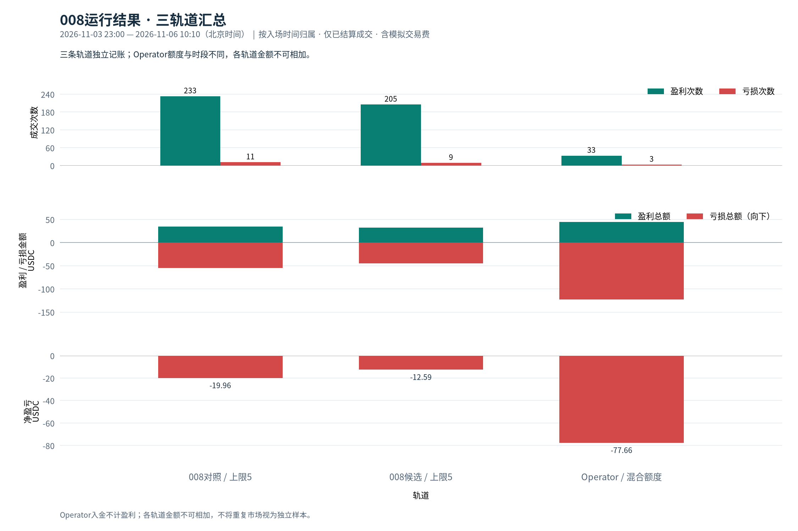](LATE_RESOLUTION_WINNER_008_HOURLY_PNL_2026-11-06.zh-CN.html#track-summary)

Operator采用过不同额度，汇总金额用于对账，不能直接比较为相同本金和额度下的策略表现。

## 008候选，ETH报价上限0.97、单笔上限5

合计：205次盈利、+32.26652530；9次亏损、−44.86094146；净盈亏-12.59441616。未成交67次，在途1笔、成本4.99627018。

### 每日自然小时明细

[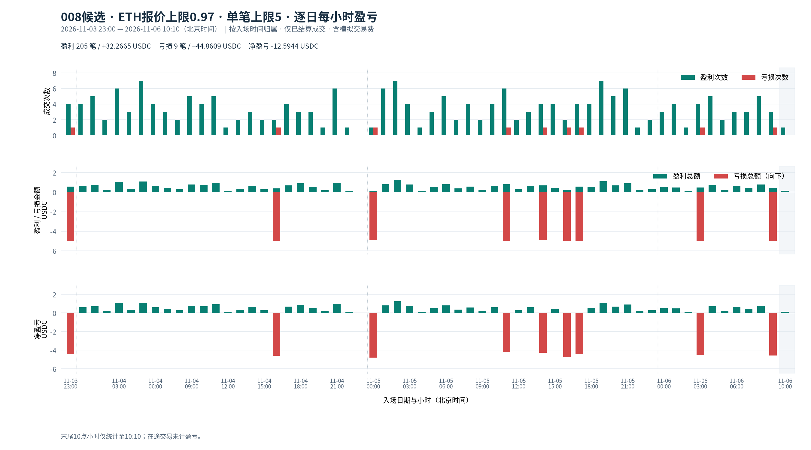](LATE_RESOLUTION_WINNER_008_HOURLY_PNL_2026-11-06.zh-CN.html#eth_cap_097-dated-all)

|时间段|盈利次数|盈利总额|亏损次数|亏损总额|净盈亏|在途|
|---|---:|---:|---:|---:|---:|---:|
|2026-11-03 23:00–00:00|4|0.5759|1|4.9952|-4.4193|0|
|2026-11-04 00:00–01:00|4|0.6258|0|0.0000|+0.6258|0|
|2026-11-04 01:00–02:00|5|0.7197|0|0.0000|+0.7197|0|
|2026-11-04 02:00–03:00|2|0.2385|0|0.0000|+0.2385|0|
|2026-11-04 03:00–04:00|6|1.0640|0|0.0000|+1.0640|0|
|2026-11-04 04:00–05:00|3|0.3334|0|0.0000|+0.3334|0|
|2026-11-04 05:00–06:00|7|1.0990|0|0.0000|+1.0990|0|
|2026-11-04 06:00–07:00|4|0.6248|0|0.0000|+0.6248|0|
|2026-11-04 07:00–08:00|3|0.4322|0|0.0000|+0.4322|0|
|2026-11-04 08:00–09:00|2|0.2899|0|0.0000|+0.2899|0|
|2026-11-04 09:00–10:00|5|0.7716|0|0.0000|+0.7716|0|
|2026-11-04 10:00–11:00|4|0.7276|0|0.0000|+0.7276|0|
|2026-11-04 11:00–12:00|5|0.9469|0|0.0000|+0.9469|0|
|2026-11-04 12:00–13:00|1|0.0948|0|0.0000|+0.0948|0|
|2026-11-04 13:00–14:00|2|0.3394|0|0.0000|+0.3394|0|
|2026-11-04 14:00–15:00|3|0.6358|0|0.0000|+0.6358|0|
|2026-11-04 15:00–16:00|2|0.2885|0|0.0000|+0.2885|0|
|2026-11-04 16:00–17:00|2|0.3873|1|4.9964|-4.6091|0|
|2026-11-04 17:00–18:00|4|0.6772|0|0.0000|+0.6772|0|
|2026-11-04 18:00–19:00|3|0.8918|0|0.0000|+0.8918|0|
|2026-11-04 19:00–20:00|3|0.5325|0|0.0000|+0.5325|0|
|2026-11-04 20:00–21:00|1|0.1951|0|0.0000|+0.1951|0|
|2026-11-04 21:00–22:00|6|0.9692|0|0.0000|+0.9692|0|
|2026-11-04 22:00–23:00|1|0.1437|0|0.0000|+0.1437|0|
|2026-11-04 23:00–00:00|0|0.0000|0|0.0000|+0.0000|0|
|2026-11-05 00:00–01:00|1|0.1437|1|4.9445|-4.8007|0|
|2026-11-05 01:00–02:00|6|0.8145|0|0.0000|+0.8145|0|
|2026-11-05 02:00–03:00|7|1.2671|0|0.0000|+1.2671|0|
|2026-11-05 03:00–04:00|4|0.7835|0|0.0000|+0.7835|0|
|2026-11-05 04:00–05:00|1|0.1437|0|0.0000|+0.1437|0|
|2026-11-05 05:00–06:00|3|0.5330|0|0.0000|+0.5330|0|
|2026-11-05 06:00–07:00|5|0.8225|0|0.0000|+0.8225|0|
|2026-11-05 07:00–08:00|2|0.3749|0|0.0000|+0.3749|0|
|2026-11-05 08:00–09:00|4|0.5759|0|0.0000|+0.5759|0|
|2026-11-05 09:00–10:00|2|0.2385|0|0.0000|+0.2385|0|
|2026-11-05 10:00–11:00|4|0.6258|0|0.0000|+0.6258|0|
|2026-11-05 11:00–12:00|6|0.8065|1|4.9964|-4.1898|0|
|2026-11-05 12:00–13:00|2|0.2885|0|0.0000|+0.2885|0|
|2026-11-05 13:00–14:00|3|0.6328|0|0.0000|+0.6328|0|
|2026-11-05 14:00–15:00|4|0.6758|1|4.9445|-4.2687|0|
|2026-11-05 15:00–16:00|4|0.4282|0|0.0000|+0.4282|0|
|2026-11-05 16:00–17:00|2|0.2385|1|4.9963|-4.7577|0|
|2026-11-05 17:00–18:00|4|0.5749|1|4.9964|-4.4214|0|
|2026-11-05 18:00–19:00|4|0.5260|0|0.0000|+0.5260|0|
|2026-11-05 19:00–20:00|7|1.1070|0|0.0000|+1.1070|0|
|2026-11-05 20:00–21:00|5|0.6707|0|0.0000|+0.6707|0|
|2026-11-05 21:00–22:00|6|0.9123|0|0.0000|+0.9123|0|
|2026-11-05 22:00–23:00|1|0.2311|0|0.0000|+0.2311|0|
|2026-11-05 23:00–00:00|2|0.2899|0|0.0000|+0.2899|0|
|2026-11-06 00:00–01:00|3|0.5330|0|0.0000|+0.5330|0|
|2026-11-06 01:00–02:00|4|0.4771|0|0.0000|+0.4771|0|
|2026-11-06 02:00–03:00|1|0.0948|0|0.0000|+0.0948|0|
|2026-11-06 03:00–04:00|4|0.4771|1|4.9952|-4.5181|0|
|2026-11-06 04:00–05:00|5|0.7197|0|0.0000|+0.7197|0|
|2026-11-06 05:00–06:00|2|0.2385|0|0.0000|+0.2385|0|
|2026-11-06 06:00–07:00|3|0.6348|0|0.0000|+0.6348|0|
|2026-11-06 07:00–08:00|3|0.4337|0|0.0000|+0.4337|0|
|2026-11-06 08:00–09:00|5|0.7726|0|0.0000|+0.7726|0|
|2026-11-06 09:00–10:00|3|0.4312|1|4.9964|-4.5652|0|
|2026-11-06 10:00–11:00|1|0.1437|0|0.0000|+0.1437|1|

### 跨日期合并的24小时分布

[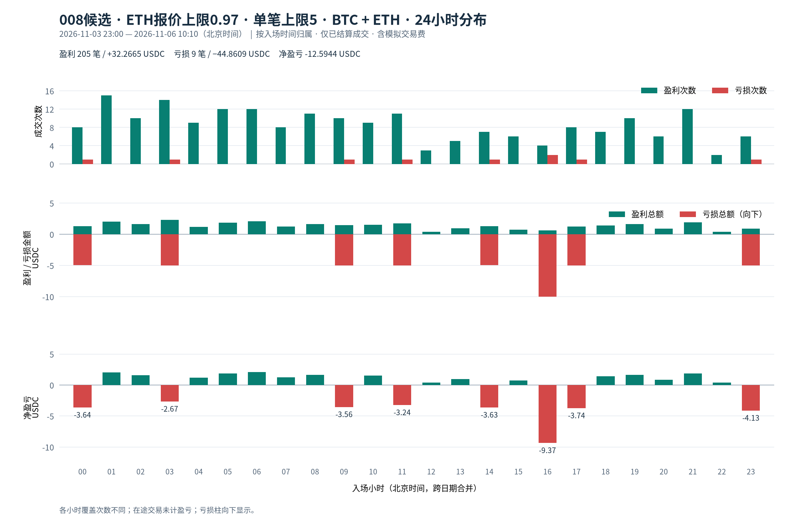](LATE_RESOLUTION_WINNER_008_HOURLY_PNL_2026-11-06.zh-CN.html#eth_cap_097-clock-all)

|时间段|盈利次数|盈利总额|亏损次数|亏损总额|净盈亏|
|---|---:|---:|---:|---:|---:|
|00:00–01:00|8|1.3026|1|4.9445|-3.6419|
|01:00–02:00|15|2.0112|0|0.0000|+2.0112|
|02:00–03:00|10|1.6004|0|0.0000|+1.6004|
|03:00–04:00|14|2.3247|1|4.9952|-2.6705|
|04:00–05:00|9|1.1967|0|0.0000|+1.1967|
|05:00–06:00|12|1.8706|0|0.0000|+1.8706|
|06:00–07:00|12|2.0821|0|0.0000|+2.0821|
|07:00–08:00|8|1.2408|0|0.0000|+1.2408|
|08:00–09:00|11|1.6384|0|0.0000|+1.6384|
|09:00–10:00|10|1.4413|1|4.9964|-3.5551|
|10:00–11:00|9|1.4972|0|0.0000|+1.4972|
|11:00–12:00|11|1.7534|1|4.9964|-3.2430|
|12:00–13:00|3|0.3833|0|0.0000|+0.3833|
|13:00–14:00|5|0.9722|0|0.0000|+0.9722|
|14:00–15:00|7|1.3116|1|4.9445|-3.6329|
|15:00–16:00|6|0.7166|0|0.0000|+0.7166|
|16:00–17:00|4|0.6258|2|9.9926|-9.3668|
|17:00–18:00|8|1.2522|1|4.9964|-3.7442|
|18:00–19:00|7|1.4178|0|0.0000|+1.4178|
|19:00–20:00|10|1.6395|0|0.0000|+1.6395|
|20:00–21:00|6|0.8659|0|0.0000|+0.8659|
|21:00–22:00|12|1.8815|0|0.0000|+1.8815|
|22:00–23:00|2|0.3749|0|0.0000|+0.3749|
|23:00–00:00|6|0.8659|1|4.9952|-4.1293|

### BTC的24小时分布

[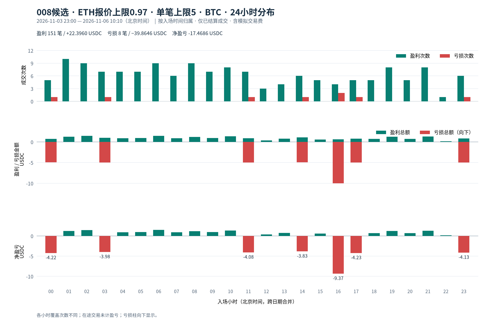](LATE_RESOLUTION_WINNER_008_HOURLY_PNL_2026-11-06.zh-CN.html#eth_cap_097-clock-btc)

|时间段|盈利次数|盈利总额|亏损次数|亏损总额|净盈亏|
|---|---:|---:|---:|---:|---:|
|00:00–01:00|5|0.7197|1|4.9445|-4.2248|
|01:00–02:00|10|1.2427|0|0.0000|+1.2427|
|02:00–03:00|9|1.4567|0|0.0000|+1.4567|
|03:00–04:00|7|1.0111|1|4.9952|-3.9841|
|04:00–05:00|7|0.9093|0|0.0000|+0.9093|
|05:00–06:00|7|0.9612|0|0.0000|+0.9612|
|06:00–07:00|9|1.4982|0|0.0000|+1.4982|
|07:00–08:00|6|0.9158|0|0.0000|+0.9158|
|08:00–09:00|9|1.1978|0|0.0000|+1.1978|
|09:00–10:00|7|0.9602|0|0.0000|+0.9602|
|10:00–11:00|8|1.3535|0|0.0000|+1.3535|
|11:00–12:00|7|0.9133|1|4.9964|-4.0831|
|12:00–13:00|3|0.3833|0|0.0000|+0.3833|
|13:00–14:00|4|0.7786|0|0.0000|+0.7786|
|14:00–15:00|6|1.1179|1|4.9445|-3.8265|
|15:00–16:00|5|0.5729|0|0.0000|+0.5729|
|16:00–17:00|4|0.6258|2|9.9926|-9.3668|
|17:00–18:00|5|0.7696|1|4.9964|-4.2268|
|18:00–19:00|5|0.7197|0|0.0000|+0.7197|
|19:00–20:00|8|1.2507|0|0.0000|+1.2507|
|20:00–21:00|5|0.7221|0|0.0000|+0.7221|
|21:00–22:00|8|1.3066|0|0.0000|+1.3066|
|22:00–23:00|1|0.1437|0|0.0000|+0.1437|
|23:00–00:00|6|0.8659|1|4.9952|-4.1293|

### ETH的24小时分布

[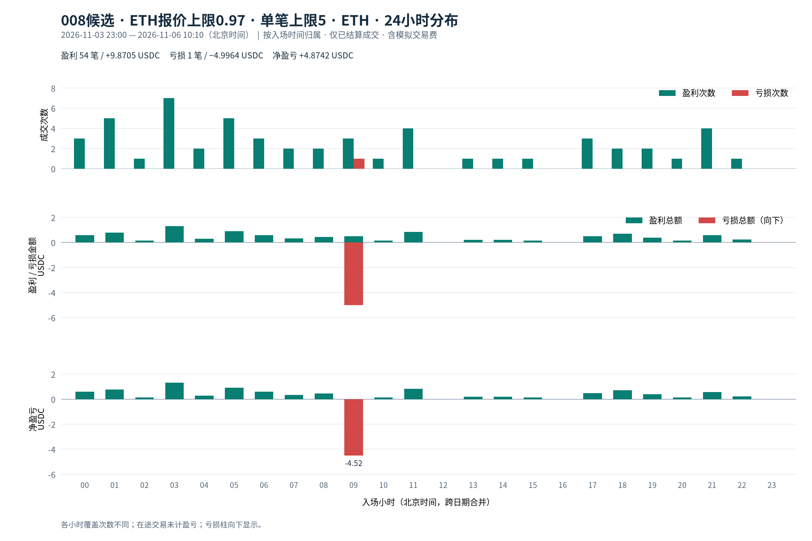](LATE_RESOLUTION_WINNER_008_HOURLY_PNL_2026-11-06.zh-CN.html#eth_cap_097-clock-eth)

|时间段|盈利次数|盈利总额|亏损次数|亏损总额|净盈亏|
|---|---:|---:|---:|---:|---:|
|00:00–01:00|3|0.5829|0|0.0000|+0.5829|
|01:00–02:00|5|0.7686|0|0.0000|+0.7686|
|02:00–03:00|1|0.1437|0|0.0000|+0.1437|
|03:00–04:00|7|1.3135|0|0.0000|+1.3135|
|04:00–05:00|2|0.2875|0|0.0000|+0.2875|
|05:00–06:00|5|0.9094|0|0.0000|+0.9094|
|06:00–07:00|3|0.5839|0|0.0000|+0.5839|
|07:00–08:00|2|0.3250|0|0.0000|+0.3250|
|08:00–09:00|2|0.4407|0|0.0000|+0.4407|
|09:00–10:00|3|0.4811|1|4.9964|-4.5152|
|10:00–11:00|1|0.1437|0|0.0000|+0.1437|
|11:00–12:00|4|0.8401|0|0.0000|+0.8401|
|12:00–13:00|0|0.0000|0|0.0000|+0.0000|
|13:00–14:00|1|0.1936|0|0.0000|+0.1936|
|14:00–15:00|1|0.1936|0|0.0000|+0.1936|
|15:00–16:00|1|0.1437|0|0.0000|+0.1437|
|16:00–17:00|0|0.0000|0|0.0000|+0.0000|
|17:00–18:00|3|0.4826|0|0.0000|+0.4826|
|18:00–19:00|2|0.6982|0|0.0000|+0.6982|
|19:00–20:00|2|0.3888|0|0.0000|+0.3888|
|20:00–21:00|1|0.1437|0|0.0000|+0.1437|
|21:00–22:00|4|0.5749|0|0.0000|+0.5749|
|22:00–23:00|1|0.2311|0|0.0000|+0.2311|
|23:00–00:00|0|0.0000|0|0.0000|+0.0000|

## 008对照，单笔上限5

合计：233次盈利、+34.88935412；11次亏损、−54.85130842；净盈亏-19.96195430。未成交84次，在途1笔、成本4.99627018。

### 每日自然小时明细

[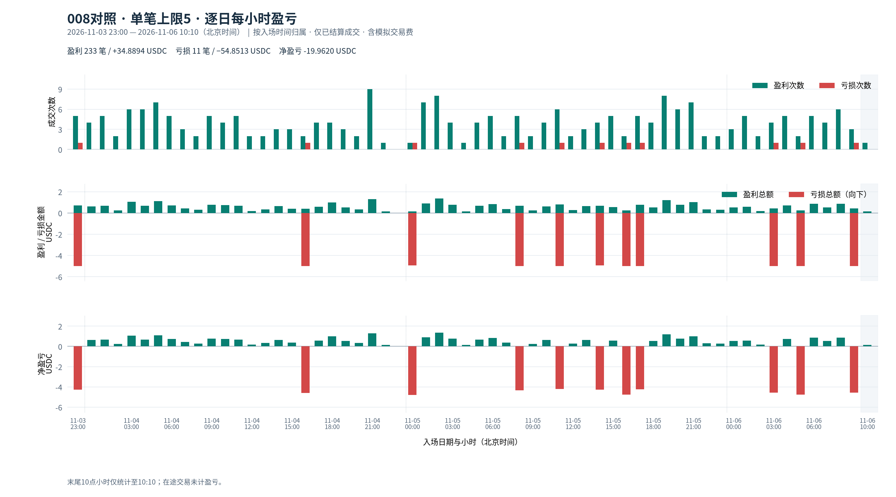](LATE_RESOLUTION_WINNER_008_HOURLY_PNL_2026-11-06.zh-CN.html#control_096_098-dated-all)

|时间段|盈利次数|盈利总额|亏损次数|亏损总额|净盈亏|在途|
|---|---:|---:|---:|---:|---:|---:|
|2026-11-03 23:00–00:00|5|0.7216|1|4.9952|-4.2735|0|
|2026-11-04 00:00–01:00|4|0.6258|0|0.0000|+0.6258|0|
|2026-11-04 01:00–02:00|5|0.6707|0|0.0000|+0.6707|0|
|2026-11-04 02:00–03:00|2|0.2385|0|0.0000|+0.2385|0|
|2026-11-04 03:00–04:00|6|1.0640|0|0.0000|+1.0640|0|
|2026-11-04 04:00–05:00|6|0.6667|0|0.0000|+0.6667|0|
|2026-11-04 05:00–06:00|7|1.0990|0|0.0000|+1.0990|0|
|2026-11-04 06:00–07:00|5|0.7197|0|0.0000|+0.7197|0|
|2026-11-04 07:00–08:00|3|0.4322|0|0.0000|+0.4322|0|
|2026-11-04 08:00–09:00|2|0.2914|0|0.0000|+0.2914|0|
|2026-11-04 09:00–10:00|5|0.7716|0|0.0000|+0.7716|0|
|2026-11-04 10:00–11:00|4|0.7276|0|0.0000|+0.7276|0|
|2026-11-04 11:00–12:00|5|0.6727|0|0.0000|+0.6727|0|
|2026-11-04 12:00–13:00|2|0.1896|0|0.0000|+0.1896|0|
|2026-11-04 13:00–14:00|2|0.3394|0|0.0000|+0.3394|0|
|2026-11-04 14:00–15:00|3|0.6358|0|0.0000|+0.6358|0|
|2026-11-04 15:00–16:00|3|0.3833|0|0.0000|+0.3833|0|
|2026-11-04 16:00–17:00|2|0.3873|1|4.9964|-4.6091|0|
|2026-11-04 17:00–18:00|4|0.5769|0|0.0000|+0.5769|0|
|2026-11-04 18:00–19:00|4|0.9866|0|0.0000|+0.9866|0|
|2026-11-04 19:00–20:00|3|0.5325|0|0.0000|+0.5325|0|
|2026-11-04 20:00–21:00|2|0.3408|0|0.0000|+0.3408|0|
|2026-11-04 21:00–22:00|9|1.3035|0|0.0000|+1.3035|0|
|2026-11-04 22:00–23:00|1|0.1437|0|0.0000|+0.1437|0|
|2026-11-04 23:00–00:00|0|0.0000|0|0.0000|+0.0000|0|
|2026-11-05 00:00–01:00|1|0.1437|1|4.9445|-4.8007|0|
|2026-11-05 01:00–02:00|7|0.9093|0|0.0000|+0.9093|0|
|2026-11-05 02:00–03:00|8|1.3619|0|0.0000|+1.3619|0|
|2026-11-05 03:00–04:00|4|0.7835|0|0.0000|+0.7835|0|
|2026-11-05 04:00–05:00|1|0.1437|0|0.0000|+0.1437|0|
|2026-11-05 05:00–06:00|4|0.6767|0|0.0000|+0.6767|0|
|2026-11-05 06:00–07:00|5|0.8225|0|0.0000|+0.8225|0|
|2026-11-05 07:00–08:00|2|0.3749|0|0.0000|+0.3749|0|
|2026-11-05 08:00–09:00|5|0.6707|1|4.9952|-4.3244|0|
|2026-11-05 09:00–10:00|2|0.2385|0|0.0000|+0.2385|0|
|2026-11-05 10:00–11:00|4|0.6258|0|0.0000|+0.6258|0|
|2026-11-05 11:00–12:00|6|0.8065|1|4.9964|-4.1898|0|
|2026-11-05 12:00–13:00|2|0.2885|0|0.0000|+0.2885|0|
|2026-11-05 13:00–14:00|3|0.6328|0|0.0000|+0.6328|0|
|2026-11-05 14:00–15:00|4|0.6758|1|4.9445|-4.2687|0|
|2026-11-05 15:00–16:00|5|0.5605|0|0.0000|+0.5605|0|
|2026-11-05 16:00–17:00|2|0.2385|1|4.9963|-4.7577|0|
|2026-11-05 17:00–18:00|5|0.7686|1|4.9964|-4.2278|0|
|2026-11-05 18:00–19:00|4|0.5260|0|0.0000|+0.5260|0|
|2026-11-05 19:00–20:00|8|1.2018|0|0.0000|+1.2018|0|
|2026-11-05 20:00–21:00|6|0.7656|0|0.0000|+0.7656|0|
|2026-11-05 21:00–22:00|7|1.0071|0|0.0000|+1.0071|0|
|2026-11-05 22:00–23:00|2|0.3260|0|0.0000|+0.3260|0|
|2026-11-05 23:00–00:00|2|0.2899|0|0.0000|+0.2899|0|
|2026-11-06 00:00–01:00|3|0.5330|0|0.0000|+0.5330|0|
|2026-11-06 01:00–02:00|5|0.5739|0|0.0000|+0.5739|0|
|2026-11-06 02:00–03:00|2|0.1896|0|0.0000|+0.1896|0|
|2026-11-06 03:00–04:00|4|0.4282|1|4.9952|-4.5670|0|
|2026-11-06 04:00–05:00|5|0.7197|0|0.0000|+0.7197|0|
|2026-11-06 05:00–06:00|2|0.2385|1|4.9952|-4.7566|0|
|2026-11-06 06:00–07:00|5|0.8753|0|0.0000|+0.8753|0|
|2026-11-06 07:00–08:00|4|0.5285|0|0.0000|+0.5285|0|
|2026-11-06 08:00–09:00|6|0.8674|0|0.0000|+0.8674|0|
|2026-11-06 09:00–10:00|3|0.4312|1|4.9964|-4.5652|0|
|2026-11-06 10:00–11:00|1|0.1437|0|0.0000|+0.1437|1|

### 跨日期合并的24小时分布

[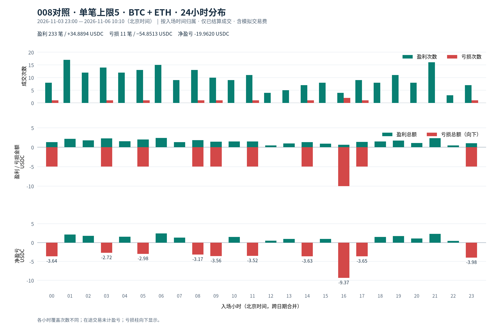](LATE_RESOLUTION_WINNER_008_HOURLY_PNL_2026-11-06.zh-CN.html#control_096_098-clock-all)

|时间段|盈利次数|盈利总额|亏损次数|亏损总额|净盈亏|
|---|---:|---:|---:|---:|---:|
|00:00–01:00|8|1.3026|1|4.9445|-3.6419|
|01:00–02:00|17|2.1539|0|0.0000|+2.1539|
|02:00–03:00|12|1.7901|0|0.0000|+1.7901|
|03:00–04:00|14|2.2757|1|4.9952|-2.7194|
|04:00–05:00|12|1.5301|0|0.0000|+1.5301|
|05:00–06:00|13|2.0143|1|4.9952|-2.9809|
|06:00–07:00|15|2.4175|0|0.0000|+2.4175|
|07:00–08:00|9|1.3356|0|0.0000|+1.3356|
|08:00–09:00|13|1.8296|1|4.9952|-3.1656|
|09:00–10:00|10|1.4413|1|4.9964|-3.5551|
|10:00–11:00|9|1.4972|0|0.0000|+1.4972|
|11:00–12:00|11|1.4793|1|4.9964|-3.5171|
|12:00–13:00|4|0.4781|0|0.0000|+0.4781|
|13:00–14:00|5|0.9722|0|0.0000|+0.9722|
|14:00–15:00|7|1.3116|1|4.9445|-3.6329|
|15:00–16:00|8|0.9438|0|0.0000|+0.9438|
|16:00–17:00|4|0.6258|2|9.9926|-9.3668|
|17:00–18:00|9|1.3455|1|4.9964|-3.6509|
|18:00–19:00|8|1.5127|0|0.0000|+1.5127|
|19:00–20:00|11|1.7343|0|0.0000|+1.7343|
|20:00–21:00|8|1.1064|0|0.0000|+1.1064|
|21:00–22:00|16|2.3107|0|0.0000|+2.3107|
|22:00–23:00|3|0.4697|0|0.0000|+0.4697|
|23:00–00:00|7|1.0116|1|4.9952|-3.9836|

### BTC的24小时分布

[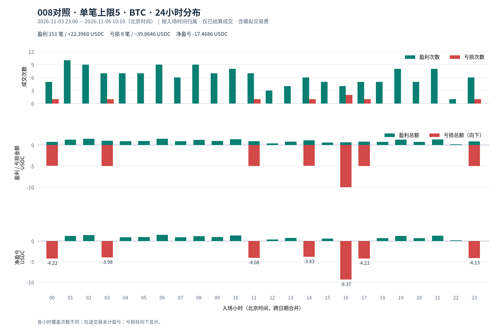](LATE_RESOLUTION_WINNER_008_HOURLY_PNL_2026-11-06.zh-CN.html#control_096_098-clock-btc)

|时间段|盈利次数|盈利总额|亏损次数|亏损总额|净盈亏|
|---|---:|---:|---:|---:|---:|
|00:00–01:00|5|0.7197|1|4.9445|-4.2248|
|01:00–02:00|10|1.2427|0|0.0000|+1.2427|
|02:00–03:00|9|1.4567|0|0.0000|+1.4567|
|03:00–04:00|7|1.0111|1|4.9952|-3.9841|
|04:00–05:00|7|0.9093|0|0.0000|+0.9093|
|05:00–06:00|7|0.9612|0|0.0000|+0.9612|
|06:00–07:00|9|1.4982|0|0.0000|+1.4982|
|07:00–08:00|6|0.9158|0|0.0000|+0.9158|
|08:00–09:00|9|1.1978|0|0.0000|+1.1978|
|09:00–10:00|7|0.9602|0|0.0000|+0.9602|
|10:00–11:00|8|1.3535|0|0.0000|+1.3535|
|11:00–12:00|7|0.9133|1|4.9964|-4.0831|
|12:00–13:00|3|0.3833|0|0.0000|+0.3833|
|13:00–14:00|4|0.7786|0|0.0000|+0.7786|
|14:00–15:00|6|1.1179|1|4.9445|-3.8265|
|15:00–16:00|5|0.5729|0|0.0000|+0.5729|
|16:00–17:00|4|0.6258|2|9.9926|-9.3668|
|17:00–18:00|5|0.7696|1|4.9964|-4.2268|
|18:00–19:00|5|0.7197|0|0.0000|+0.7197|
|19:00–20:00|8|1.2507|0|0.0000|+1.2507|
|20:00–21:00|5|0.7221|0|0.0000|+0.7221|
|21:00–22:00|8|1.3066|0|0.0000|+1.3066|
|22:00–23:00|1|0.1437|0|0.0000|+0.1437|
|23:00–00:00|6|0.8659|1|4.9952|-4.1293|

### ETH的24小时分布

[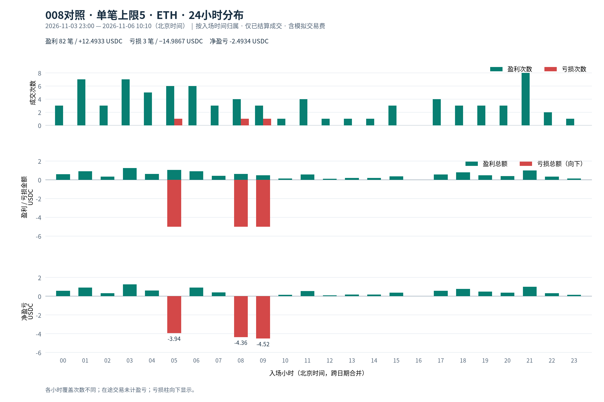](LATE_RESOLUTION_WINNER_008_HOURLY_PNL_2026-11-06.zh-CN.html#control_096_098-clock-eth)

|时间段|盈利次数|盈利总额|亏损次数|亏损总额|净盈亏|
|---|---:|---:|---:|---:|---:|
|00:00–01:00|3|0.5829|0|0.0000|+0.5829|
|01:00–02:00|7|0.9113|0|0.0000|+0.9113|
|02:00–03:00|3|0.3334|0|0.0000|+0.3334|
|03:00–04:00|7|1.2646|0|0.0000|+1.2646|
|04:00–05:00|5|0.6208|0|0.0000|+0.6208|
|05:00–06:00|6|1.0531|1|4.9952|-3.9421|
|06:00–07:00|6|0.9193|0|0.0000|+0.9193|
|07:00–08:00|3|0.4198|0|0.0000|+0.4198|
|08:00–09:00|4|0.6318|1|4.9952|-4.3634|
|09:00–10:00|3|0.4811|1|4.9964|-4.5152|
|10:00–11:00|1|0.1437|0|0.0000|+0.1437|
|11:00–12:00|4|0.5660|0|0.0000|+0.5660|
|12:00–13:00|1|0.0948|0|0.0000|+0.0948|
|13:00–14:00|1|0.1936|0|0.0000|+0.1936|
|14:00–15:00|1|0.1936|0|0.0000|+0.1936|
|15:00–16:00|3|0.3709|0|0.0000|+0.3709|
|16:00–17:00|0|0.0000|0|0.0000|+0.0000|
|17:00–18:00|4|0.5759|0|0.0000|+0.5759|
|18:00–19:00|3|0.7930|0|0.0000|+0.7930|
|19:00–20:00|3|0.4836|0|0.0000|+0.4836|
|20:00–21:00|3|0.3843|0|0.0000|+0.3843|
|21:00–22:00|8|1.0041|0|0.0000|+1.0041|
|22:00–23:00|2|0.3260|0|0.0000|+0.3260|
|23:00–00:00|1|0.1457|0|0.0000|+0.1457|

## Operator，历史额度有调整

合计：33次盈利、+44.89337867；3次亏损、−122.55417666；净盈亏-77.66079799。未成交31次，在途1笔、成本49.99186291。

### 每日自然小时明细

[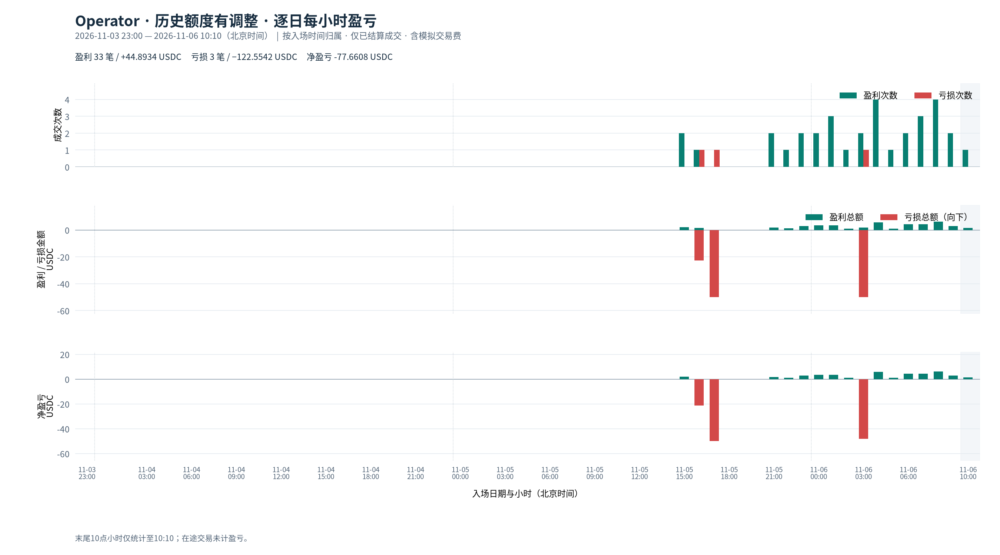](LATE_RESOLUTION_WINNER_008_HOURLY_PNL_2026-11-06.zh-CN.html#operator-dated-all)

|时间段|盈利次数|盈利总额|亏损次数|亏损总额|净盈亏|在途|
|---|---:|---:|---:|---:|---:|---:|
|2026-11-03 23:00–00:00|0|0.0000|0|0.0000|+0.0000|0|
|2026-11-04 00:00–01:00|0|0.0000|0|0.0000|+0.0000|0|
|2026-11-04 01:00–02:00|0|0.0000|0|0.0000|+0.0000|0|
|2026-11-04 02:00–03:00|0|0.0000|0|0.0000|+0.0000|0|
|2026-11-04 03:00–04:00|0|0.0000|0|0.0000|+0.0000|0|
|2026-11-04 04:00–05:00|0|0.0000|0|0.0000|+0.0000|0|
|2026-11-04 05:00–06:00|0|0.0000|0|0.0000|+0.0000|0|
|2026-11-04 06:00–07:00|0|0.0000|0|0.0000|+0.0000|0|
|2026-11-04 07:00–08:00|0|0.0000|0|0.0000|+0.0000|0|
|2026-11-04 08:00–09:00|0|0.0000|0|0.0000|+0.0000|0|
|2026-11-04 09:00–10:00|0|0.0000|0|0.0000|+0.0000|0|
|2026-11-04 10:00–11:00|0|0.0000|0|0.0000|+0.0000|0|
|2026-11-04 11:00–12:00|0|0.0000|0|0.0000|+0.0000|0|
|2026-11-04 12:00–13:00|0|0.0000|0|0.0000|+0.0000|0|
|2026-11-04 13:00–14:00|0|0.0000|0|0.0000|+0.0000|0|
|2026-11-04 14:00–15:00|0|0.0000|0|0.0000|+0.0000|0|
|2026-11-04 15:00–16:00|0|0.0000|0|0.0000|+0.0000|0|
|2026-11-04 16:00–17:00|0|0.0000|0|0.0000|+0.0000|0|
|2026-11-04 17:00–18:00|0|0.0000|0|0.0000|+0.0000|0|
|2026-11-04 18:00–19:00|0|0.0000|0|0.0000|+0.0000|0|
|2026-11-04 19:00–20:00|0|0.0000|0|0.0000|+0.0000|0|
|2026-11-04 20:00–21:00|0|0.0000|0|0.0000|+0.0000|0|
|2026-11-04 21:00–22:00|0|0.0000|0|0.0000|+0.0000|0|
|2026-11-04 22:00–23:00|0|0.0000|0|0.0000|+0.0000|0|
|2026-11-04 23:00–00:00|0|0.0000|0|0.0000|+0.0000|0|
|2026-11-05 00:00–01:00|0|0.0000|0|0.0000|+0.0000|0|
|2026-11-05 01:00–02:00|0|0.0000|0|0.0000|+0.0000|0|
|2026-11-05 02:00–03:00|0|0.0000|0|0.0000|+0.0000|0|
|2026-11-05 03:00–04:00|0|0.0000|0|0.0000|+0.0000|0|
|2026-11-05 04:00–05:00|0|0.0000|0|0.0000|+0.0000|0|
|2026-11-05 05:00–06:00|0|0.0000|0|0.0000|+0.0000|0|
|2026-11-05 06:00–07:00|0|0.0000|0|0.0000|+0.0000|0|
|2026-11-05 07:00–08:00|0|0.0000|0|0.0000|+0.0000|0|
|2026-11-05 08:00–09:00|0|0.0000|0|0.0000|+0.0000|0|
|2026-11-05 09:00–10:00|0|0.0000|0|0.0000|+0.0000|0|
|2026-11-05 10:00–11:00|0|0.0000|0|0.0000|+0.0000|0|
|2026-11-05 11:00–12:00|0|0.0000|0|0.0000|+0.0000|0|
|2026-11-05 12:00–13:00|0|0.0000|0|0.0000|+0.0000|0|
|2026-11-05 13:00–14:00|0|0.0000|0|0.0000|+0.0000|0|
|2026-11-05 14:00–15:00|0|0.0000|0|0.0000|+0.0000|0|
|2026-11-05 15:00–16:00|2|1.9928|0|0.0000|+1.9928|0|
|2026-11-05 16:00–17:00|1|1.4381|1|22.5707|-21.1326|0|
|2026-11-05 17:00–18:00|0|0.0000|1|49.9924|-49.9924|0|
|2026-11-05 18:00–19:00|0|0.0000|0|0.0000|+0.0000|0|
|2026-11-05 19:00–20:00|0|0.0000|0|0.0000|+0.0000|0|
|2026-11-05 20:00–21:00|0|0.0000|0|0.0000|+0.0000|0|
|2026-11-05 21:00–22:00|2|1.7259|0|0.0000|+1.7259|0|
|2026-11-05 22:00–23:00|1|1.2001|0|0.0000|+1.2001|0|
|2026-11-05 23:00–00:00|2|2.9013|0|0.0000|+2.9013|0|
|2026-11-06 00:00–01:00|2|3.4710|0|0.0000|+3.4710|0|
|2026-11-06 01:00–02:00|3|3.3360|0|0.0000|+3.3360|0|
|2026-11-06 02:00–03:00|1|0.9489|0|0.0000|+0.9489|0|
|2026-11-06 03:00–04:00|2|1.8978|1|49.9911|-48.0933|0|
|2026-11-06 04:00–05:00|4|5.7628|0|0.0000|+5.7628|0|
|2026-11-06 05:00–06:00|1|0.9489|0|0.0000|+0.9489|0|
|2026-11-06 06:00–07:00|2|4.4147|0|0.0000|+4.4147|0|
|2026-11-06 07:00–08:00|3|4.3395|0|0.0000|+4.3395|0|
|2026-11-06 08:00–09:00|4|6.2010|0|0.0000|+6.2010|0|
|2026-11-06 09:00–10:00|2|2.8763|0|0.0000|+2.8763|0|
|2026-11-06 10:00–11:00|1|1.4381|0|0.0000|+1.4381|1|

### 跨日期合并的24小时分布

[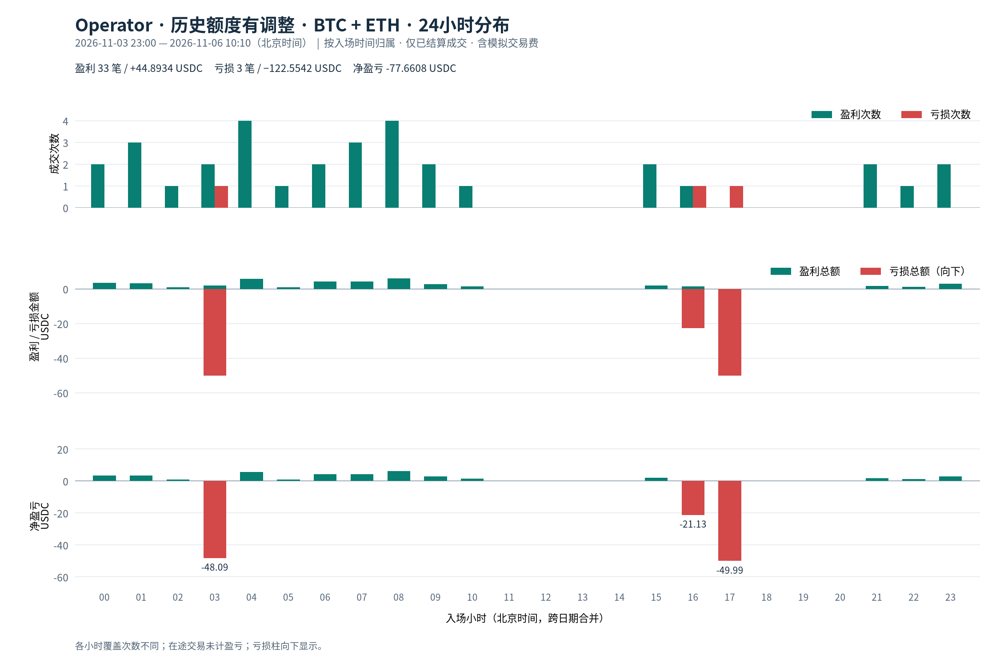](LATE_RESOLUTION_WINNER_008_HOURLY_PNL_2026-11-06.zh-CN.html#operator-clock-all)

|时间段|盈利次数|盈利总额|亏损次数|亏损总额|净盈亏|
|---|---:|---:|---:|---:|---:|
|00:00–01:00|2|3.4710|0|0.0000|+3.4710|
|01:00–02:00|3|3.3360|0|0.0000|+3.3360|
|02:00–03:00|1|0.9489|0|0.0000|+0.9489|
|03:00–04:00|2|1.8978|1|49.9911|-48.0933|
|04:00–05:00|4|5.7628|0|0.0000|+5.7628|
|05:00–06:00|1|0.9489|0|0.0000|+0.9489|
|06:00–07:00|2|4.4147|0|0.0000|+4.4147|
|07:00–08:00|3|4.3395|0|0.0000|+4.3395|
|08:00–09:00|4|6.2010|0|0.0000|+6.2010|
|09:00–10:00|2|2.8763|0|0.0000|+2.8763|
|10:00–11:00|1|1.4381|0|0.0000|+1.4381|
|11:00–12:00|0|0.0000|0|0.0000|+0.0000|
|12:00–13:00|0|0.0000|0|0.0000|+0.0000|
|13:00–14:00|0|0.0000|0|0.0000|+0.0000|
|14:00–15:00|0|0.0000|0|0.0000|+0.0000|
|15:00–16:00|2|1.9928|0|0.0000|+1.9928|
|16:00–17:00|1|1.4381|1|22.5707|-21.1326|
|17:00–18:00|0|0.0000|1|49.9924|-49.9924|
|18:00–19:00|0|0.0000|0|0.0000|+0.0000|
|19:00–20:00|0|0.0000|0|0.0000|+0.0000|
|20:00–21:00|0|0.0000|0|0.0000|+0.0000|
|21:00–22:00|2|1.7259|0|0.0000|+1.7259|
|22:00–23:00|1|1.2001|0|0.0000|+1.2001|
|23:00–00:00|2|2.9013|0|0.0000|+2.9013|

### BTC的24小时分布

[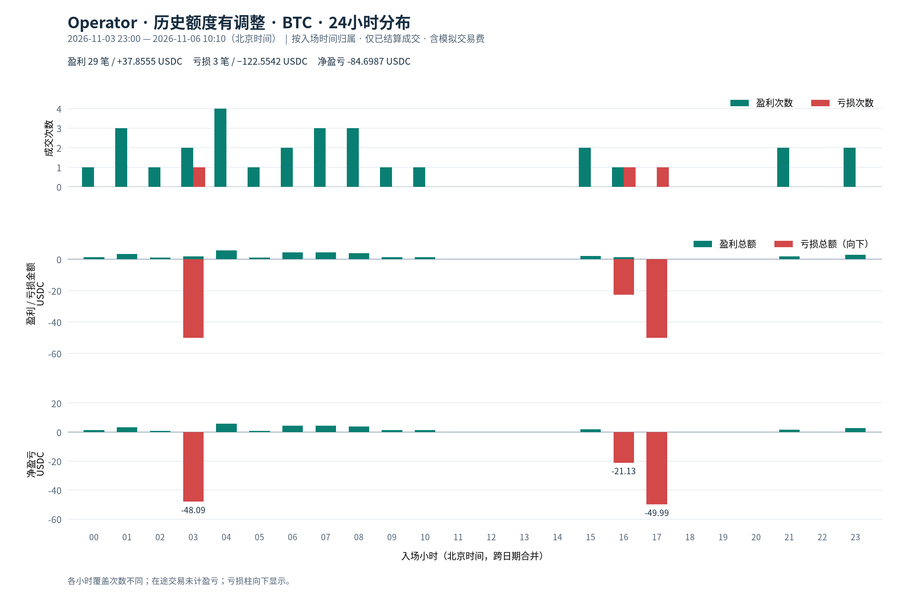](LATE_RESOLUTION_WINNER_008_HOURLY_PNL_2026-11-06.zh-CN.html#operator-clock-btc)

|时间段|盈利次数|盈利总额|亏损次数|亏损总额|净盈亏|
|---|---:|---:|---:|---:|---:|
|00:00–01:00|1|1.4370|0|0.0000|+1.4370|
|01:00–02:00|3|3.3360|0|0.0000|+3.3360|
|02:00–03:00|1|0.9489|0|0.0000|+0.9489|
|03:00–04:00|2|1.8978|1|49.9911|-48.0933|
|04:00–05:00|4|5.7628|0|0.0000|+5.7628|
|05:00–06:00|1|0.9489|0|0.0000|+0.9489|
|06:00–07:00|2|4.4147|0|0.0000|+4.4147|
|07:00–08:00|3|4.3395|0|0.0000|+4.3395|
|08:00–09:00|3|3.8354|0|0.0000|+3.8354|
|09:00–10:00|1|1.4381|0|0.0000|+1.4381|
|10:00–11:00|1|1.4381|0|0.0000|+1.4381|
|11:00–12:00|0|0.0000|0|0.0000|+0.0000|
|12:00–13:00|0|0.0000|0|0.0000|+0.0000|
|13:00–14:00|0|0.0000|0|0.0000|+0.0000|
|14:00–15:00|0|0.0000|0|0.0000|+0.0000|
|15:00–16:00|2|1.9928|0|0.0000|+1.9928|
|16:00–17:00|1|1.4381|1|22.5707|-21.1326|
|17:00–18:00|0|0.0000|1|49.9924|-49.9924|
|18:00–19:00|0|0.0000|0|0.0000|+0.0000|
|19:00–20:00|0|0.0000|0|0.0000|+0.0000|
|20:00–21:00|0|0.0000|0|0.0000|+0.0000|
|21:00–22:00|2|1.7259|0|0.0000|+1.7259|
|22:00–23:00|0|0.0000|0|0.0000|+0.0000|
|23:00–00:00|2|2.9013|0|0.0000|+2.9013|

### ETH的24小时分布

[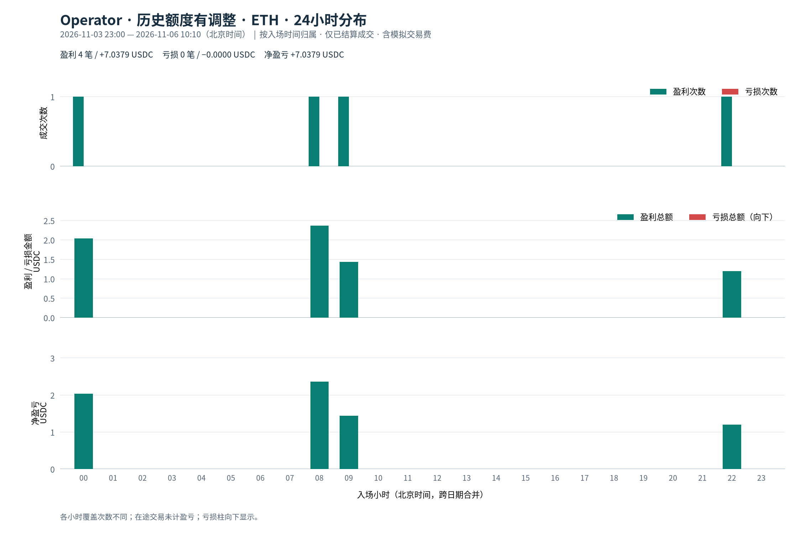](LATE_RESOLUTION_WINNER_008_HOURLY_PNL_2026-11-06.zh-CN.html#operator-clock-eth)

|时间段|盈利次数|盈利总额|亏损次数|亏损总额|净盈亏|
|---|---:|---:|---:|---:|---:|
|00:00–01:00|1|2.0340|0|0.0000|+2.0340|
|01:00–02:00|0|0.0000|0|0.0000|+0.0000|
|02:00–03:00|0|0.0000|0|0.0000|+0.0000|
|03:00–04:00|0|0.0000|0|0.0000|+0.0000|
|04:00–05:00|0|0.0000|0|0.0000|+0.0000|
|05:00–06:00|0|0.0000|0|0.0000|+0.0000|
|06:00–07:00|0|0.0000|0|0.0000|+0.0000|
|07:00–08:00|0|0.0000|0|0.0000|+0.0000|
|08:00–09:00|1|2.3656|0|0.0000|+2.3656|
|09:00–10:00|1|1.4381|0|0.0000|+1.4381|
|10:00–11:00|0|0.0000|0|0.0000|+0.0000|
|11:00–12:00|0|0.0000|0|0.0000|+0.0000|
|12:00–13:00|0|0.0000|0|0.0000|+0.0000|
|13:00–14:00|0|0.0000|0|0.0000|+0.0000|
|14:00–15:00|0|0.0000|0|0.0000|+0.0000|
|15:00–16:00|0|0.0000|0|0.0000|+0.0000|
|16:00–17:00|0|0.0000|0|0.0000|+0.0000|
|17:00–18:00|0|0.0000|0|0.0000|+0.0000|
|18:00–19:00|0|0.0000|0|0.0000|+0.0000|
|19:00–20:00|0|0.0000|0|0.0000|+0.0000|
|20:00–21:00|0|0.0000|0|0.0000|+0.0000|
|21:00–22:00|0|0.0000|0|0.0000|+0.0000|
|22:00–23:00|1|1.2001|0|0.0000|+1.2001|
|23:00–00:00|0|0.0000|0|0.0000|+0.0000|

## 文件与校验

同目录`hourly-pnl.json`保存入场/结算两种时间口径、逐日自然小时及24小时分布，均按轨道和BTC/ETH拆分。`hourly-pnl.py`可在仓库根目录运行复现。

输入完整性及资金守恒由现有固定轨道和Operator审计器验证；每小时累加与总账盈利/亏损次数、累计成本、净盈亏、未成交及在途数一致，BTC+ETH与合计一致。

静态预览由 `hourly-charts.py` 生成；交互版由 `hourly-echarts.py` 生成。两者共用 `hourly-pnl.json`，ECharts 和数据均嵌入交互版 HTML，可离线打开。
