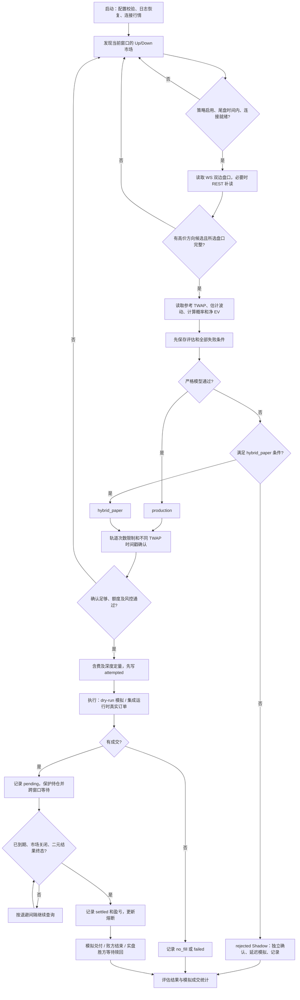
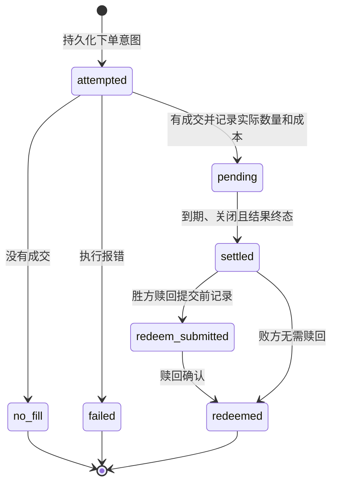

# Late-Resolution Winner Trading：流程、软件算法与数学依据

整理日期：2026-10-21。依据当前工作区源码；仓库 HEAD 为 `9940397`，工作区另有未提交的研究文件。本文描述实现及其假设，不把历史运行参数当作代码默认值，也不把模型概率当作已验证的真实胜率。

## 1. 策略做什么

该策略在加密货币 Up/Down 市场结束前的短时间内，寻找报价很高的潜在胜方，通过独立参考价格模型复核后，买入单边 outcome token，持有到市场确认结算。

核心链条是：**尾盘盘口识别方向 → Chainlink TWAP 检验方向和剩余波动 → 检验含费收益空间 → 多次行情确认 → 限额买入 → 等待正式结果 → 结算及赎回 → 统计验证**。

收益来自买入成本与胜方最终兑付之间的差额。普通二元结果下，胜方每份兑付 1，败方为 0；实际市场规则决定结果及例外情况。[Polymarket 结算说明](https://docs.polymarket.com/concepts/resolution)

例如，每份含费成本为 0.98 时，买对赚 0.02，买错亏 0.98。高胜率是这一收益结构的必要条件；盘口显示“接近 1”并不消除尾盘反转风险。

代码中的 `YES` 对应 Up，`NO` 对应 Down。市场发现器筛选具有 Up/Down outcomes 的市场，并按 token 数组第一个为 Up、第二个为 Down 读取；这是当前实现的顺序假设。策略名称中的 `late resolution` 指临近结束时交易，实际入场条件仍要求窗口剩余时间大于 0，并非等到正式结算后才买入。

### 1.1 三条路径的边界

| 路径 | 准入方式 | 是否进入订单状态 journal | 是否占用模拟资金 | 解释 |
|---|---|---|---|---|
| `production` | 完整严格模型通过 | 是 | dry-run 下是 | 严格策略标签；这个名称本身不代表实盘 |
| `hybrid_paper` | 完整模型拒绝，但满足较窄研究条件 | 是 | 是 | 只能 dry-run，用于校准研究 |
| rejected Shadow | 被前两条路径拒绝的候选，经独立确认后做模拟观察 | 否，写入评估 journal | 否 | 测量反事实可成交性和结算收益 |

另有 sensitivity Shadow：改变波动率下限和风险缓冲的缩放比例，测量模型敏感性。它属于研究观察，不修改 `production` 准入。

## 2. 总体流程



上图中的循环是逻辑循环。窗口运行时通过异步事件循环和定时 Tick 推进；正式持仓和评估结果的结算检查独立于新入场开关继续进行。

### 2.1 启动、隔离与恢复

独立入口 `late_resolution_winner_trading` 有两个子命令：

- `dry-run`，也是无参数默认行为：调用共享运行时的 `LateResolutionWinnerTradingDryRun` profile，强制 `DRY_RUN=true`、关闭其他交易策略及自动 merge/wind-down。
- `backtest`：运行本地历史数据回放。

因此，独立策略程序不是实盘入口。共享运行时保留真实下单路径，但当前代码要求 live/canary 在交互式 `polypulse` TUI 中运行。

启动时读取 `orders.ndjson`，恢复 pending 持仓、待赎回胜方、累计花费、已实现盈亏和亏损熔断；dry-run 还据此恢复模拟现金。`evaluations.ndjson` 恢复尚未取得终态标签的候选。每次启动产生新的 `run_id`，用于区分不同运行批次。

### 2.2 新入场的外层条件

当前 `app.rs` 的尾盘分支要求：

1. 策略控制开关启用；
2. `0 < seconds_until_end <= BEFORE_END_SECS`，默认最后 30 秒；
3. market WebSocket 状态为 Connected；
4. user WebSocket 已连接；
5. 对应市场未用完执行尝试次数。

REST 补读位于这个分支内部，不能概括为“WS 断线后也照常用 REST 交易”。次数限制针对已持久化的下单尝试，扫描、模型拒绝和等待确认不会消耗一次尝试；no-fill 和执行失败发生在尝试之后，仍消耗次数。

## 3. 软件算法：数据、候选与确认

### 3.1 两种输入数据各司其职

| 数据 | 当前实现 | 作用 |
|---|---|---|
| outcome 盘口 | CLOB market WS 缓存，必要时 REST | 提供候选方向、bid/ask、可见 ask 数量 |
| 参考价格 | RTDS `crypto_prices_twap_sixty` | 提供开盘附近参考、当前参考和波动估计 |
| 市场终态 | Gamma closed-market 查询 | 给实际持仓及候选补结算标签 |
| 市场费率 | `winner_fee_policy` 读取市场规则 | 取得费率和指数，计算每份估计费用 |

策略没有在本地从 spot 价格重新聚合 60 秒 TWAP。它消费上游已经计算好的 TWAP；Chainlink spot 或 Binance spot 在共享模块中只作其他研究数据，不替代本策略的 TWAP。

**接口版本注记：**以上是仓库现状。2026-10-21 核对的官方文档已给出 RTDS → PolyBolt 迁移：旧 `crypto_prices_twap_sixty` 映射到 `price.crypto.twap`，参考价格订阅需要认证，新十进制价格不能继续按旧 E18 转换。本次仅整理文档，未测试旧端点在线可用性，也未修改接入代码。[官方迁移说明](https://docs.polymarket.com/migrate/rtds-to-polybolt)

### 3.2 时间序列存储与价格精度

`ChainlinkTwapStore` 使用 `HashMap<asset, VecDeque<TwapSample>>`：

- 去除非正价格及非法时间戳；乱序旧样本丢弃，同一时间戳的样本覆盖，不追加为新观测。
- 每个资产保留约 10 分钟历史，用于开盘锚点和波动估计。
- 价格、资金、费用及份额主要用 `Decimal`；平方根、标准正态 CDF 等统计计算使用 `f64`。
- 旧 RTDS 的 Chainlink `full_accuracy_value` 按 E18 转换；Binance 人类可读价格不作 E18 除法。
- 订阅重连与数据看门狗检查有效的新 TWAP 时间戳；连接收到了 PONG，不等于参考价格仍在更新。

算法目的：维持按事件时间排列的价格序列，避免重复消息增加样本数，避免把网络存活误认为模型数据有效。

### 3.3 盘口新鲜度与选择性 REST 回退

`received_at_is_fresh` 判定：

$$
0 \le t_{check}-t_{received} \le A_{book}.
$$

默认 `A_book=1000ms`。处理步骤为：

1. 先取 YES/NO WS 盘口，在废弃旧缓存前计算一个初步方向候选。
2. 两边均新鲜则直接使用；缺少盘口则补读缺少的一边或两边。
3. 两边缓存都有但已过期时，仅在缓存仍显示潜在方向候选时补读；无候选则跳过，以减少尾盘 REST 请求。
4. 需要同时补读两边时用 `tokio::join!` 并行请求。
5. REST 整段请求耗时超过默认 3000ms 则丢弃结果；请求结束后用新的检查时间再次验证两边年龄。

这个设计同时约束“多久以前收到”和“请求本身阻塞多久”。收到时间新鲜不等于服务端盘口的真实生成时间一定新鲜，当前门槛主要依据本地收到时间。

### 3.4 高价方向候选检测

`detect_winner_asks` 只根据两边最优 ask 识别候选，规则为：

$$
q_{chosen}\in[q_{min},q_{max}],\qquad
q_{opposite}\le0.10\ \text{或没有 opposite ask}.
$$

默认价格区间 `[0.95,0.99]`，包含端点；反向低价上限 `0.10` 也包含端点。函数内部还将下限钳制到 `[0.5,0.999]`，上限钳制到 `[下限,0.9999]`。

YES 高、NO 低则买 YES；NO 高、YES 低则买 NO。两边都高、都没有可执行 ask，或胜方价格超区间，均不产生候选。反向 ask 缺失是允许的，但被买入的一边必须有完整、可用的 bid、ask 和 ask size。

这是候选筛选启发式。真正的模型准入还要经过下文的盘口质量、TWAP 方向、反转边界和净 EV 检查。

### 3.5 不同参考时间戳的连续确认

`WinnerConfirmationTracker` 按 slug 保存方向、最后 TWAP 事件时间及确认数：

- 首次合格观察记 1 次；只有严格更大的 `observed_at_ms` 才增加计数。
- 买入方向改变，或两次参考时间戳间距超过 TTL，重新从 1 计数。
- 默认需要 3 次；TTL 是 `FEED_MAX_AGE_MS × 3`，默认 15 秒。
- 对于数据缺失、盘口无信号或严格路径被拒绝等分支，调用者会清除相应确认状态。

因此，同一条 TWAP 被循环读取三次仍只有一次确认。确认用于抑制瞬时信号；三条相邻 TWAP 通常高度相关，不能据此把三个概率相乘。

## 4. 数学模型及准入条件

### 4.1 符号和单位

| 符号 | 含义 | 单位 |
|---|---|---|
| `t0`、`t`、`T` | 窗口开始、评估时刻、剩余时间 | 时间戳 / 秒 |
| `A0`、`At` | 开盘附近和当前 TWAP | 标的美元价格 |
| `d` | 买 Up 为 +1，买 Down 为 −1 | 无量纲 |
| `m` | 沿买入方向的 TWAP 变动 | bps，1bp=0.01% |
| `σ` | 采用的短期波动率 | bps/√秒 |
| `sT` | 剩余时间波动尺度 `σ√T` | bps |
| `q`、`b` | 被买 token 的 ask、bid | 每份价格 |
| `f(q)`、`c` | 每份估计费用、含费有效成本 | 每份金额 |
| `p` | 当前扩散近似给出的胜率 | 概率 |
| `r`、`e` | 模型风险缓冲、最低净 EV | 每份金额 / 概率点 |
| `Q`、`B` | 下单份额、单笔现金上限 | 份 / USDC |

outcome 单份兑付归一化为 1 后，概率差与每份期望金额在数值上相同。因此 `p-c` 可以解释为每份期望收益；0.002 是每份 0.002 的门槛，不是本金收益率 0.2%。

### 4.2 开盘锚点和数据可用性

`evaluate` 从缓存中选择距离 `t0` 最近、满足下式的样本作为 `A0`：

$$
|t_{sample}-t_0|\le K_{open},\qquad K_{open}=5000ms\ \text{（默认）}.
$$

这个锚点可能位于开盘前或开盘后，默认偏差最多 5 秒；它是实现上的边界近似，并不证明与交易所最终使用的开盘参考逐位相同。缺少锚点就拒绝，不用当前 spot 替代。

当前 TWAP 默认最多老 5000ms。`effective_sample_age_ms` 允许发布者时钟领先本机最多 10000ms，并把这段有界负年龄视为 0；领先更多则拒绝。波动率默认取最近 120 秒至少 10 个观测。

### 4.3 方向距离

先算相对于开盘的简单收益，再转换成 bps：

$$
m=d\left(\frac{A_t}{A_0}-1\right)10^4.
$$

例如 `At/A0=1.0012`：买 Up 的 `m=12bps`，买 Down 的 `m=-12bps`。符号必须保留；取绝对值会把方向相反的价格变化误读成支持信号。

### 4.4 短期波动率估计

对回看区间内相邻 TWAP 样本，令：

$$
\Delta t_i=(t_i-t_{i-1})/1000,\qquad
u_i=\frac{10^4(A_i/A_{i-1}-1)}{\sqrt{\Delta t_i}}.
$$

当前软件计算的是标准化收益的均方根：

$$
\widehat\sigma_{obs}=\sqrt{\frac1N\sum_{i=1}^{N}u_i^2},\qquad
\sigma=\max(\widehat\sigma_{obs},\sigma_{floor}).
$$

`N` 是有效相邻增量数，不是原始样本数；非正时间差和非法价格的增量不参与。这里没有减样本均值、没有 `N-1` 修正，也没有 EWMA 或 GARCH。

数学动机是：若短时间价格收益近似零漂移扩散，增量方差随时间线性增长，即 `Var(ΔR)≈σ²Δt`，则除以 `√Δt` 后可把不同采样间隔放到同一尺度。严格说，这是当前实现使用的扩散启发式；对不等间隔数据，它也不等同于所有连续时间模型的最大似然估计。

资产默认下限分别为 BTC `0.8`、ETH `1.2`、其他 `1.5 bps/√秒`。下限防止短样本或平滑 TWAP 令波动估计过低、模型胜率过高。它们是保守参数，不是由某条数学定理推导出来的真实波动常数。

### 4.5 剩余时间尺度与胜率

实现将 `T` 至少取 1 秒：

$$
T=\max(seconds\_remaining,1),\qquad s_T=\sigma\sqrt T.
$$

概率公式可由以下**模型假设**解释：沿买入方向、相对开盘的终点距离近似为：

$$
M_{end}=m+s_T Z,\qquad Z\sim N(0,1).
$$

于是：

$$
p_{raw}=P(M_{end}>0)=\Phi\!\left(\frac m{s_T}\right),\qquad
p=\operatorname{clip}(p_{raw},0.0001,0.9999).
$$

分母在实现中另设 `10^-6` 数值下限。`normal_cdf` 通过标准正态密度和多项式近似计算 CDF，没有调用期权定价模型。若方向不利，`m<0`，概率可以低于 0.5；源码没有把所有高价候选的概率强行抬到 0.5 以上。

这不是完整 Black–Scholes 数字期权模型：没有拟合漂移、风险中性测度、隐含波动率曲面或 TWAP 的精确条件分布。它给出的是工程化的终点胜率近似。

### 4.6 反转边界

代码另外要求方向距离严格大于：

$$
H=m_{min}+k s_T,\qquad m>H.
$$

默认 `m_min=3bps`，`k=2`。这表示当前领先距离需要覆盖固定最小余量和两倍剩余波动尺度；`m=H` 仍拒绝。

在理想零漂移正态假设下，单独的 `m>2sT` 对应终点落败概率低于约 2.28%。这是模型内的终点概率解释，并不等于“路径中途不会反转”，也不证明真实市场具有相同尾部概率。固定 3bps 进一步收紧条件。

审计特征 `reversal_margin_ratio=m/H` 保留符号。严格模型通过这一项意味着比值大于 1；研究中 `r_ratio=0.20` 只是达到边界的 20%，不能解释为完整边界已经通过。本文的风险缓冲 `r` 与这一距离比是两个不同量。

### 4.7 费用、含费成本与净 EV

市场规则提供费率 `a` 和指数 `η`，当前 `fee_per_share` 实现为：

$$
f(q)=a[q(1-q)]^\eta.
$$

参数按市场读取，未将所有加密市场永久写死为某个费率。官方现行费用说明给出的 `C × feeRate × p × (1-p)` 是该表达式在 `η=1` 时的总费用形式；具体市场参数及费用舍入仍应以市场规则为准。[Polymarket 费用说明](https://docs.polymarket.com/trading/fees)

评估使用：

$$
c=\min(q+f(q),1),\qquad
edge=p-c,\qquad EV_{net}=p-c-r.
$$

完整 EV 条件为：

$$
EV_{net}\ge e
\quad\Longleftrightarrow\quad
p\ge p_{required}=c+r+e.
$$

由二元支付直接推导：单份获胜利润 `1-c`，失败亏损 `-c`，所以未扣模型缓冲的真实期望在胜率为 `p` 时为：

$$
p(1-c)+(1-p)(-c)=p-c.
$$

模型风险缓冲默认 BTC `0.010`、ETH `0.015`、其他 `0.020`；最低净 EV 默认 `0.002`。缓冲是概率/收益空间的保守扣减，不是额外支付给平台的手续费。

若 `p_required>0.9999`，当前模型概率上限已使该报价不可能通过 EV，即使通过反转边界也不会下单。

以下只作算例：假设市场返回 `a=0.07、η=1`，采用默认风险缓冲和最低 EV：

| ask | 每份费用 | 有效成本 c | BTC 所需 p | ETH 所需 p |
|---:|---:|---:|---:|---:|
| 0.95 | 0.003325 | 0.953325 | 0.965325 | 0.970325 |
| 0.96 | 0.002688 | 0.962688 | 0.974688 | 0.979688 |
| 0.97 | 0.002037 | 0.972037 | 0.984037 | 0.989037 |
| 0.98 | 0.001372 | 0.981372 | 0.993372 | 0.998372 |
| 0.99 | 0.000693 | 0.990693 | 1.002693，不可达 | 1.007693，不可达 |

这解释了“买入价越接近 1，越难获得有余量的正 EV”：便宜的手续费并不能补回被高买入价压缩的获胜利润。

### 4.8 盘口质量与完整准入

严格模型还要求：

$$
b>0,\quad 0\le q-b\le Spread_{max},\quad q\times AskSize\ge Depth_{min}.
$$

默认最大绝对价差 `0.03`，最优 ask 档名义深度至少 `10 USDC`。这里的深度不是整本订单簿总量，spread 也不是标的价格的 bps。

完整条件是：数据可用、盘口合格、`m>H`、`p-c-r>=e` 同时成立。源码保留 `failed_checks` 全部失败项，并将按检查顺序排在最前的失败项作为 `rejection`。数据不足、无锚点等早期失败会直接返回，部分数值字段因此只是占位零。

结合概率公式，在参数有效且 `p_required<=0.9999` 时，可把主要数学门槛理解为：

$$
m>m_{min}+ks_T,\qquad
m\ge s_T\Phi^{-1}(c+r+e).
$$

这只是便于解释的等价边界；源码直接计算 CDF，再比较 EV，没有求逆 CDF。

## 5. 从信号到执行

### 5.1 含费与可见深度共同定量

`fee_inclusive_depth_capped_size` 先按含费成本转换现金上限，再受当前最优 ask 数量约束：

$$
Q=\min\left(
\frac{\lfloor100B/c\rfloor}{100},
\frac{\lfloor100\max(AskSize,0)\rfloor}{100}
\right).
$$

份额向下截断到两位小数，避免四舍五入突破现金上限。`Q<=0` 则跳过。报价深度可以满足 10 USDC 准入，却不足以支撑一笔 50 USDC 请求；上述定量将这种情况转为较小订单。

这不是 Kelly 仓位算法，也不是根据置信度连续加仓。当前主要依赖固定现金上限、可见深度、独立策略额度及风险预留。

### 5.2 提交前的资金与风险顺序

通过确认后：

1. 再检查策略开关，生成 `position_id`，计算 `planned_cost=cQ`。
2. 检查持久化的全策略亏损、单资产亏损和连续亏损熔断。
3. 在独立的 Winner `PositionTracker` 预留敞口，避免并发交易共同超限。
4. 检查共享 live/canary safety gate。
5. 将 `attempted` 同步写入状态 journal；写成功后才增加轨道及市场尝试数，再调用执行器。

`production` 与 `hybrid_paper` 有独立的每窗口次数限制和单笔上限；两者仍共享该策略资金、敞口约束及每市场尝试限制。不能由“独立轨道次数”推导出“两个独立账户”。

### 5.3 dry-run 的延迟成交模拟

`buy_winner` 在 dry-run 下先预留模拟现金，再进入 `simulate_delayed_winner`：

1. 等待默认 250ms 的模拟执行延迟。
2. REST 重新读取真实盘口。
3. 取 `price<=原限价` 的 ask 档，按价格由低到高排序。
4. 各档可执行量乘 `PAPER_LIQUIDITY_HAIRCUT`，默认 `0.75`。
5. 若订单类型为 FOK 且折扣后总深度不够，整单不成交；其他模拟类型按可用量立即成交，允许部分成交。
6. 逐档累计数量和成本，再将成交份额向下截断到两位小数；按截断比例调整成本。
7. 加入 `filled × f(信号报价)` 的估计费用，将含费总成本除以份额作为 `average_price`。
8. 成交成本提交到模拟账本，未使用的预留现金释放。

Shadow 调用相同延迟模拟，但不预留现金、不修改模拟账本。多个 Shadow 可以分别测量同一市场的反事实可成交性，所以汇总 Shadow 收益也不是一套已经遵守全组合资本约束的真实资金曲线。

模拟订单类型共用 `BINARY_COMPLEMENT_ARBITRAGE_ORDER_TYPE` 配置；不能把 Winner 的每次模拟一概称为 FOK。paper 中非 FOK 的即时成交模拟也不等同于真实 GTC/GTD 的后续挂单撮合。

### 5.4 live 路径与成本字段

live 路径构建、签名并提交买单，从返回的 `making_amount/taking_amount` 提取实际付出、得到份额和均价。它使用共享订单类型；live canary 的配置校验只接受 FOK/FAK。

当前 live 返回 `estimated_fee=0`，以交易所返回金额和份额作为成本来源。因此是否完整体现真实手续费，取决于交易所字段的净额语义和后续账户核对，不能把 paper 的费用估算直接当成 live 费用凭证。

paper 的 `average_price` **已经包含估计费用**。后续持仓成本为 `filled × price`，`fee` 是单独记录的诊断字段，不应再次从 PnL 中扣一次。界面中的 `filled × (1-fill_price)` 或“胜时利润”仍以获胜为前提，只有正式结算 PnL 才计入已实现结果。

## 6. 持仓、结算、赎回与持久化

### 6.1 状态机



dry-run 胜方也记录模拟赎回完成，以闭合相同生命周期；真实胜方在结果确认后仍可能停留于 awaiting_redeem。只有获胜方向且启用 `AUTO_REDEEM`、具备相应凭据时，才走真实自动赎回。

pending 和等待赎回的 token 会加入受保护集合，供共享风控避免把持有到结算的头寸当作普通待平仓头寸。跨窗口不会丢弃 pending；重启从 journal 重建。

### 6.2 何时允许结算

`settle_late_resolution_winner_trading` 要求同时满足：

- 本地时间已经到 `end_date`；
- Gamma 返回 `closed=true`；
- outcome prices 呈现唯一终态：一边 `>=0.999`，另一边 `<=0.001`。

只有高报价、时间到期或 `closed` 任一条件均不够。若结果为中间值、信息缺失或不符合上述二元终态，继续等待；该函数不处理 0.5/0.5 一类特殊支付结果。

对成交份额 `Qf`、持仓单位成本 `cf`：

$$
PnL=\begin{cases}
Q_f(1-c_f), & \text{所持方向获胜},\\
-Q_fc_f, & \text{所持方向失败}.
\end{cases}
$$

结果未知时不会先按“看起来赢了”入账。查询失败或结果尚不可见时，`SettlementBackoff` 按 slug 使用 `10、20、40、60、60…秒` 的退避，成功后清除。这个退避状态在内存中，订单及结算事实在 journal 中。

### 6.3 两份 journal 的分工

| 文件 | 主要记录 | 主键/关联 |
|---|---|---|
| `orders.ndjson` | attempted、pending、no_fill、failed、settled、redeem_submitted、redeemed | `position_id`，关联 `evaluation_id` |
| `evaluations.ndjson` | run、候选特征、完整拒绝项、确认进度、Shadow、敏感性、候选及市场结果 | `evaluation_id`、slug、`run_id` |

保存被拒候选是为了检验“模型拒绝的机会后来怎样”，避免只观察通过者。`record_resolution` 为候选逐个补标签，并写市场汇总选择记录；Shadow 的实际模拟结果必须关联自己的 evaluation，不能随意拿另一次更晚评估的方向和特征来结算。

### 6.4 幂等与写入安全

当前实现采用追加式事件恢复和幂等检查：

- 下单意图先持久化，再发送交易；成交、结算和赎回分阶段写入。
- 同一 `position_id` 不重复记 pending 或已实现 PnL；同一 `evaluation_id` 最多持久化一条 `shadow_executed`。
- 主 rejected Shadow 与 sensitivity 在同次评估满足条件时共享延迟盘口读取和执行结果，事件携带多个 cohort。
- 文件有进程级独占锁；每次追加执行完整序列化、换行、write、flush、sync。
- 默认保留 2GiB 磁盘空间。**当前代码的预写空间不足可重试**；真实 write/flush/sync 失败才永久将 writer 置为 fail-closed，并尝试截回原长度。这与部分旧运行文档记录的永久空间拒写行为不同。
- evaluation journal 可隔离坏行、恢复已知残缺前缀后的完整事件；状态 journal 的中段损坏阻止恢复，残缺尾行会被隔离。报告中完整性失败时，数据仅可诊断。

这些机制提供本地恢复及去重依据；本地事件唯一并不等同于交易所和本地存储形成原子事务。进程若在“交易已发生、成交尚未持久化”之间崩溃，仍需核对账户和订单状态。启动发现已提交但未确认的赎回时，会触发不确定写状态保护。

### 6.5 亏损熔断的数学口径

持久化的策略亏损量为：

$$
L_{strategy}=\sum_i\max(-PnL_i,0),\qquad
L_{asset}=\sum_{i\in asset}\max(-PnL_i,0).
$$

这两个量只累计负收益，盈利不冲减。连续亏损数在负收益时加 1，在非负收益时归零。默认阈值分别为策略 20、单资产 10 USDC、连续 3 次。

它们不是“净 PnL 小于 −20”、不是相对资金高点的最大回撤，也没有自动每日重置。熔断在下一次新入场前检查，不能保证未结算持仓的最终亏损一定不越过阈值。

## 7. 研究路径：hybrid、Shadow 与组合筛选

### 7.1 当前 hybrid_paper 的精确条件

`winner_research_cohorts` 先标记 `hybrid_chainlink_veto`：ask 在 `[0.96,0.98]`、有模型参考且方向距离 `m>0`、获胜后仍有正支付空间、spread 和深度符合常规门槛。

实际进入 hybrid 订单生命周期还需要：

1. 严格模型没有通过；
2. `HYBRID_PAPER_ENABLED=true` 且 `DRY_RUN=true`；
3. **原模型 `model.net_ev>=0`**；
4. 命中上述 cohort；
5. 继续满足确认、次数、资金和风控约束。

因此，cohort 名称只表示分组资格，不能单独作为“已下单”或“允许负 EV 入场”的依据。hybrid 相对严格路径可以放宽完整边界或最低正 EV 门槛，但当前代码仍阻止负模型净 EV 进入订单生命周期。默认每笔 5 USDC、每窗口 1 次；live 配置开启 hybrid 会直接校验失败。

### 7.2 rejected Shadow 和敏感性

rejected Shadow 对有模型观测时间的被拒候选进行独立确认，确认后每市场在窗口内最多进行一次主观察。它可能带着边界、净 EV、深度等拒绝原因，目的正是测量拒绝者的结果，不能把其成交理解为模型放行。

敏感性路径在 dry-run 且 `LATE_RESOLUTION_WINNER_TRADING_SENSITIVITY_ENABLED=true` 时启用，使用：

$$
f_{scale}\in\{1,0.5,0.25,0.1\},\qquad
r_{scale}\in\{1,0.5\}.
$$

每组重新计算 `σ=max(σobs,σfloor×fscale)`、概率、边界和扣减 `risk×rscale` 后的 EV；保留原盘口质量拒绝条件，每组各自确认，不替换运行中的严格模型。

### 7.3 冻结组合研究在流程中的位置

`scripts/late_resolution_winner_combination_study.py` 是读取 journal 的离线研究，不是额外在线准入器。它将报价 `ask`、原始模型概率 `p`、有符号距离比 `m/H` 和剩余时间组合筛选。

现有冻结候选包括：`p>=0.70`、最后 20 秒、排除高价且低概率、再加入低距离比的三条件交集，以及按报价分档的概率/距离要求。阈值详见[原研究计划](LATE_RESOLUTION_WINNER_COMBINATION_STUDY_2026-10-05.zh-CN.md)。这些是待验证的特征规则，`p>=0.70` 绝不等于在 0.97 成本下自动具有正 EV。

软件验证过程：

1. 冻结输入 journal 的前缀字节数、行数和 SHA256，并对登记计划计算摘要。
2. 固定未来完整市场窗口起点和允许的 `run_id`，分开历史基线、同步缺口及正式前瞻。
3. 按主 Shadow 执行及其 `evaluation_id` 关联特征和结算；排除 sensitivity-only，并保留 no-fill、pending 和未知特征。
4. 分 ETH/BTC、保留/剔除/未知组及北京时间日期统计。
5. 同时计算避免亏损和放弃盈利，不用亏损命中率替代净收益。

若 control 的总 PnL 可完整划分，且只做同一批执行结果的事后筛选，则：

$$
PnL_{control}=PnL_{kept}+PnL_{removed},\qquad
\Delta PnL=PnL_{kept}-PnL_{control}=-PnL_{removed}.
$$

过滤有效需要被剔除组的总亏损大于其中放弃的利润；它不等同于“剔除了大部分负场”。存在未知组时应单列，不能硬套两组恒等式。此类子集回放也不模拟因过滤而释放资金后产生的新交易。

2026-10-19 的本地复核结论是未推进冻结候选，继续研究；这是带日期的研究结论，不能当成今日实时账户状态。参见[续接计划](LATE_RESOLUTION_WINNER_COMBINATION_CONTINUATION_2026-10-12.zh-CN.md)和[首次复核](LATE_RESOLUTION_WINNER_COMBINATION_REVIEW_2026-10-19.zh-CN.md)。

## 8. 如何判断策略是否有证据支持

### 8.1 胜率、成本和收益必须一起看

对已结算成交 `i`，设获胜标签 `yi∈{0,1}`、成交份额 `Qi`、含费成本 `Ci`：

$$
PnL=\sum_i(Q_i y_i-C_i),\qquad
ROI=\frac{\sum_i(Q_i y_i-C_i)}{\sum_iC_i}.
$$

上述为已结算口径，组合研究脚本据此计算。Rust 报告的订单 stage 汇总目前将所有已成交持仓成本计入 `capital`，可能包含 pending，分子仍为已实现 PnL；因此该汇总在存在未结算头寸时，不能直接与上述已结算 ROI 混用。

成本近似相同、份额可比时，盈亏平衡胜率为 `pBE=c`。报告也给出加权成本门槛：

$$
\bar c=\frac{\sum_i C_i}{\sum_i Q_i}.
$$

拿按笔计算的观察胜率直接与 `c̄` 比较，隐含各笔胜率和份额具有可比性；份额或成本差异大时，应以逐笔总 PnL 为准。ROI 的分母是累计已结算投入成本，不能直接解释为初始资金收益率或年化回报。

高成本支付的尾部不对称可写为：

$$
\frac{\text{一次失败的亏损}}{\text{一次成功的利润}}=\frac c{1-c}.
$$

当 `c=0.98`，一次失败抵消 49 次同份额成功。故观察到“多数时候都赢”，仍可能整体亏损。

### 8.2 Wilson 胜率下界

`late_resolution_winner_report` 用二项比例 Wilson 区间的下界提示小样本不确定性。设已结算 `n` 笔、胜 `w` 笔，`p̂=w/n`，`z≈1.959964`：

$$
p_L=\frac{\hat p+z^2/(2n)-z\sqrt{\hat p(1-\hat p)/n+z^2/(4n^2)}}{1+z^2/n}.
$$

它是双侧 95% Wilson 区间的下端，代码显示为 `lower95`。例如 100 笔全胜，下界也只有约 96.30%，不足以证明成本 0.98 的交易具有正期望。[NIST 对 Wilson 区间的说明](https://www.itl.nist.gov/div898/handbook/prc/section2/prc241.htm)

相同时间的 BTC/ETH、同一行情阶段及重复候选可能相关；同一市场多次评估不能当成多笔独立胜负。Wilson 的名义区间不会修复相关性、市场状态变化或反复挑选最佳阈值导致的偏差。

### 8.3 模型校准与数据口径

报告按资产、价格、剩余时间、stage 和研究 cohort 分组，并统计模型概率与结果差异。其 Brier 指标为：

$$
Brier=\frac1n\sum_i(p_i-y_i)^2.
$$

它用于评估概率预测误差，值越小表示该样本上的平方误差越小；不能单独替代获利评估。数据缺失时的 `model_probability=0` 是占位值，必须结合开盘参考、时间戳和拒绝项排除，不能解释成“模型预测必败”。

报告中的 `Strict-model execution readiness: N/100` 统计的是 `orders.ndjson` 中已完全结算的 `production` 成交。**100 是报告提示的最低评审节点，当前代码不会据此自动切换实盘，也不是共享运行时读取的硬性授权门槛。** Shadow 或 hybrid 成交不能补足这 100 笔。

Rust 报告有按市场选择评估的摘要，冻结组合研究则按主 Shadow 执行关联评估并去重。两种选择规则有不同用途，不能假定所有分组行数完全一致；评估数、候选市场数、下单尝试数、成交数和已结算成交数也应分别报告。

## 9. 一笔完整算例

以下为计算示例，不是实时交易信号。假设 BTC 买 Up、剩余 20 秒，其他数据及盘口条件均有效，并且已经获得足够的不同时间戳确认：

| 输入 | 数值 |
|---|---:|
| 方向距离 m | 12bps，例如 TWAP 从 100000 到 100120 |
| 观测波动率 | 0.5bps/√秒 |
| BTC 波动下限 | 0.8bps/√秒 |
| ask / bid | 0.97 / 0.96 |
| ask size | 20 份，名义深度 19.4 USDC |
| 市场费率及指数 | 假设 0.07、1 |
| 风险缓冲 / 最低净 EV | 0.010 / 0.002 |
| 单笔预算 | 5 USDC |

计算：

1. `σ=max(0.5,0.8)=0.8`，`sT=0.8√20≈3.577709bps`。
2. `H=3+2sT≈10.155418bps`；`12>H`，边界通过。
3. `z=12/sT≈3.354102`，`p≈0.999602`，尚未触及 0.9999 上限。
4. `f=0.07×0.97×0.03=0.002037`，`c=0.972037`。
5. `p_required=0.984037`；`net_EV≈0.017565>=0.002`，EV 通过。
6. `spread=0.01<=0.03`，深度 `19.4>=10`，盘口质量通过。
7. `Q=min(floor(100×5/0.972037)/100,20)=5.14` 份，计划成本 `4.99627018`。

若延迟后仍能按该价格与假设费用足量成交，胜时利润 `0.14372982`，败时亏损 `4.99627018`；一次失败约抵消 34.76 次同额成功。模型风险扣减后的期望贡献约为 `Q×net_EV≈0.090284`，它与“获胜时利润”是不同指标。

若把方向距离改为 6bps，虽然方向仍然为正且盘口没变，但 `m<H`，严格模型拒绝。若买入价改为 0.99，默认 BTC 缓冲下所需概率大于 1，EV 条件不可满足。

## 10. 数学和执行近似的边界

以下直接影响如何解读当前算法：

1. **TWAP 的相关性。**若原始价格为 `S(t)`，连续时间滚动均价可写作 `A(t)=L^-1∫[t-L,t]S(u)du`，此处 `L=60秒`。相邻 TWAP 共享大部分窗口，增量不必独立。对于平稳离散增量 `xi`，`Var(Σxi)=nγ0+2Σ[k=1..n-1](n-k)γk`；当前 `σ√T` 近似没有显式估计这些协方差项。因此，低短期 TWAP 波动不自动等于低终点风险，波动率下限只能缓解，不能证明校准正确。
2. **开盘及方向假设。**最近开盘样本、Up/Down token 顺序和实际市场结算源必须对应。模型没有逐市场验证完整结算文字，也没有证明边界附近样本就是官方最终锚点。当前价格缓存仅保留约 10 分钟，按这一淘汰逻辑，15 分钟窗口尾盘的开盘样本已超出保留期，会造成 `NoOpeningReference`；不能从运行参数支持 15 分钟推导出该周期的策略已具备有效模型输入。
3. **时间及消息语义。**Winner 的 `evaluate` 使用缓存最新样本并容忍有界未来时间戳，没有像共享模块中的部分 fair-value 研究 API 那样逐样本严格过滤 `sample_time<=now`。另外，盘口补读后虽重新验证盘口年龄，传入 Winner 模型的 `now` 和剩余时间仍来自本次 Tick；不能把整个流程描述为在发单前原子重算了所有输入。
4. **成交条件改变。**排队、撤单、延迟和逆向选择可能使成交样本的真实胜率低于所有候选。0.75 深度折扣和 250ms 延迟只是模拟假设，不包含完整撮合队列、真实网络尾延迟和资金竞争。
5. **费用口径。**模型使用信号报价估费；paper 在延迟模拟后仍用该每份费率加费用，live 依赖返回金额。最终收益评估需保持含费均价和份额语义一致，不能重复扣费，也不能默认已覆盖所有链上和赎回成本。
6. **历史回放不等于线上同一实现。**`replay_winner_market_grid` 复用候选及模型，但有独立的确认计数、场景延迟和深度遍历；回放使用六位份额、执行均价相对配置上限检查，并非完全复刻在线两位份额、原信号逐档限价及 TTL 逻辑。应把回放用作场景证据，不能声称已经逐笔复现线上执行。
7. **研究参数不是生产常量。**旧批次可能采用两次确认或每笔 5 USDC；源码默认是三次和严格轨道 50 USDC。比较研究结果时应按 run、构建和配置区分，不能把历史阈值拼接成一个不存在的策略。

## 11. 参数和源码索引

### 11.1 主要默认参数

下表中的环境变量均加前缀 `LATE_RESOLUTION_WINNER_TRADING_`，订单类型除外；具体运行值由环境和配置覆盖。

| 后缀 | 默认值 | 作用 |
|---|---:|---|
| `ENABLED` | false | 集成运行时初始开关；独立 dry-run profile 会强制启用 |
| `BEFORE_END_SECS` | 30 | 尾盘扫描区间 |
| `MIN_PRICE` / `MAX_PRICE` | 0.95 / 0.99 | 高价候选区间 |
| `BUDGET_USDC` | 50 | 策略独立额度；未设置时兼容回退到 paper 初始额度配置 |
| `MAX_ORDER_USDC` / `MAX_PER_WINDOW` | 50 / 1 | 严格轨道单笔现金上限、每窗口尝试上限；窗口 0 表示不限 |
| `MAX_ATTEMPTS_PER_MARKET` | 1 | 每市场执行尝试数 |
| `MAX_BOOK_AGE_MS` / `MAX_REST_LATENCY_MS` | 1000 / 3000 | 本地盘口年龄、补读延迟约束 |
| `FEED_MAX_AGE_MS` / `OPENING_MAX_SKEW_MS` | 5000 / 5000 | TWAP 年龄、开盘锚点容差 |
| `VOLATILITY_LOOKBACK_SECS` / `MIN_OBSERVATIONS` | 120 / 10 | 波动回看、最低原始观测数 |
| `CONFIRMATION_OBSERVATIONS` | 3 | 不同 TWAP 时间戳确认数 |
| `MIN_MARGIN_BPS` / `REVERSAL_SIGMA` | 3 / 2 | 固定余量与反转边界倍数 |
| `BTC_MIN_VOLATILITY_BPS` / `ETH_MIN_VOLATILITY_BPS` / `OTHER_MIN_VOLATILITY_BPS` | 0.8 / 1.2 / 1.5 | bps/√秒，名称虽含 bps，单位不能省略时间尺度 |
| `BTC_MODEL_RISK_BUFFER` / `ETH_MODEL_RISK_BUFFER` / `OTHER_MODEL_RISK_BUFFER` | 0.010 / 0.015 / 0.020 | 模型风险扣减 |
| `MAX_SPREAD` / `MIN_DEPTH_USDC` / `MIN_NET_EV` | 0.03 / 10 / 0.002 | 盘口和净 EV 门槛 |
| `HYBRID_PAPER_ENABLED` | false | 开启研究订单轨道 |
| `HYBRID_PAPER_MAX_ORDER_USDC` / `HYBRID_PAPER_MAX_PER_WINDOW` | 5 / 1 | hybrid 单笔及窗口限制 |
| `PAPER_EXECUTION_DELAY_MS` / `PAPER_LIQUIDITY_HAIRCUT` | 250 / 0.75 | 延迟和可执行深度折扣 |
| `MAX_STRATEGY_LOSS_USDC` / `MAX_ASSET_LOSS_USDC` / `MAX_CONSECUTIVE_LOSSES` | 20 / 10 / 3 | 持久化亏损熔断；连续亏损设 0 关闭该项 |
| `AUTO_REDEEM` | false | 实盘自动赎回开关 |
| `JOURNAL_MIN_FREE_BYTES` | 2147483648 | 每次追加前磁盘保留线 |

### 11.2 实现映射

| 环节 | 文件及主要符号 |
|---|---|
| 独立入口 | [src/bin/late_resolution_winner_trading.rs](../src/bin/late_resolution_winner_trading.rs)：`main` |
| profile、扫描、准入、提交和结算编排 | [src/app.rs](../src/app.rs)：`apply_runtime_profile`、`run`、`late_resolution_winner_model_policy`、`record_winner_shadow` |
| 市场识别 | [src/market/discoverer.rs](../src/market/discoverer.rs)：Up/Down outcomes、token 顺序和 end_date |
| 参考序列和概率模型 | [src/late_resolution_winner_model.rs](../src/late_resolution_winner_model.rs)：`ChainlinkTwapStore::evaluate`、`volatility_bps_per_sqrt_second`、`normal_cdf` |
| 连续确认及敏感性 | 同上：`WinnerConfirmationTracker`、`attempt_allowed`、`sensitivity_decision` |
| 候选、定量、终态判定 | [src/late_resolution_winner_trading.rs](../src/late_resolution_winner_trading.rs)：`detect_winner_asks`、`fee_inclusive_depth_capped_size`、`settle_late_resolution_winner_trading` |
| 研究分组和持久化 | 同上：`winner_research_cohorts`、`WinnerEvaluationJournal`、`LateResolutionWinnerTradingJournal`、`DurableNdjsonWriter` |
| 费用和执行 | [src/trading/executor.rs](../src/trading/executor.rs)：`WinnerFeePolicy`、`winner_fee_policy`、`buy_winner`、`shadow_buy_winner`、`simulate_delayed_winner` |
| 模拟成交与资金 | [src/trading/paper.rs](../src/trading/paper.rs)：`simulate_buy`、`PaperLedger`、`PaperReservation` |
| 独立敞口和预留 | [src/risk/positions.rs](../src/risk/positions.rs)：`PositionTracker`、`reserve` |
| 全局安全门 | [src/live_safety.rs](../src/live_safety.rs)：`try_start_winner`、`record_winner_settlement` |
| 默认值及互斥条件 | [src/config.rs](../src/config.rs)：`Config::from_env`、配置校验 |
| 历史场景回放 | [src/polybacktest.rs](../src/polybacktest.rs)：`run_late_resolution_winner_replay`、`replay_winner_market_grid` |
| 分轨道及置信统计 | [src/bin/late_resolution_winner_report.rs](../src/bin/late_resolution_winner_report.rs)：`wilson_lower_bound`、`load_order_stage_stats`、`main` |
| 冻结组合前瞻验证 | [scripts/late_resolution_winner_combination_study.py](../scripts/late_resolution_winner_combination_study.py)：`register_plan`、`snapshot_inputs`、`analyze_plan`、`stats` |

### 11.3 本地使用入口

以下为命令说明，本文整理过程未启动策略或修改运行参数：

```bash
# 真实行情、模拟执行；独立入口强制 dry-run
cargo run --release --bin late_resolution_winner_trading -- dry-run

# 本地历史回放，需要先配置/准备对应数据库
cargo run --release --bin late_resolution_winner_trading -- backtest

# 读取评估及同目录 orders.ndjson，路径按实际批次替换
cargo run --release --bin late_resolution_winner_report -- \
  results/late-resolution-winner-trading/paper/evaluations.ndjson

# 读取现有冻结计划及本地 journal，生成离线组合研究报告
python3 scripts/late_resolution_winner_combination_study.py analyze
```

并行运行不同周期时应使用各自的 journal、日志路径和可观测端口，避免文件锁冲突或混合研究样本。与运行结果有关的阶段判断，应继续以对应 run 的配置、完整 journal 及已结算样本为依据。
