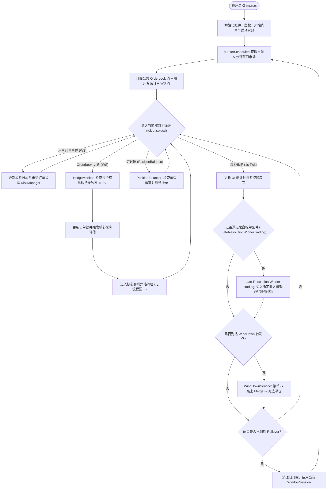
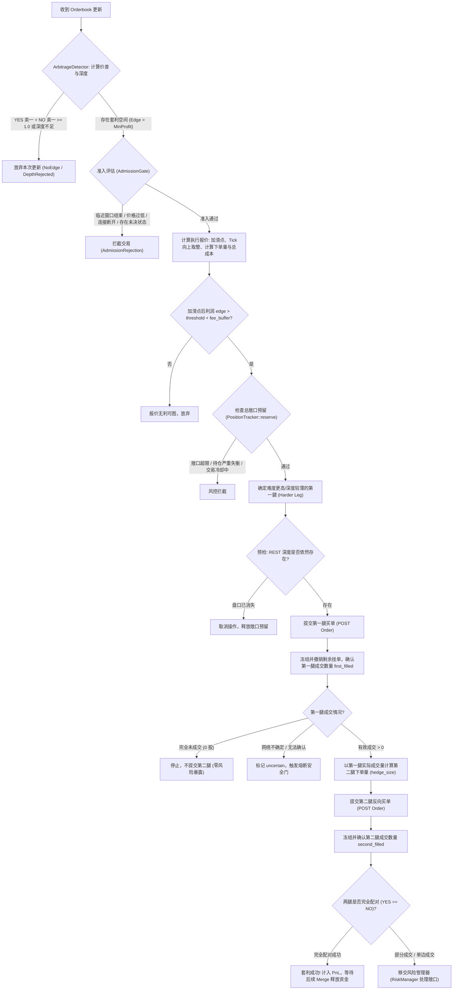
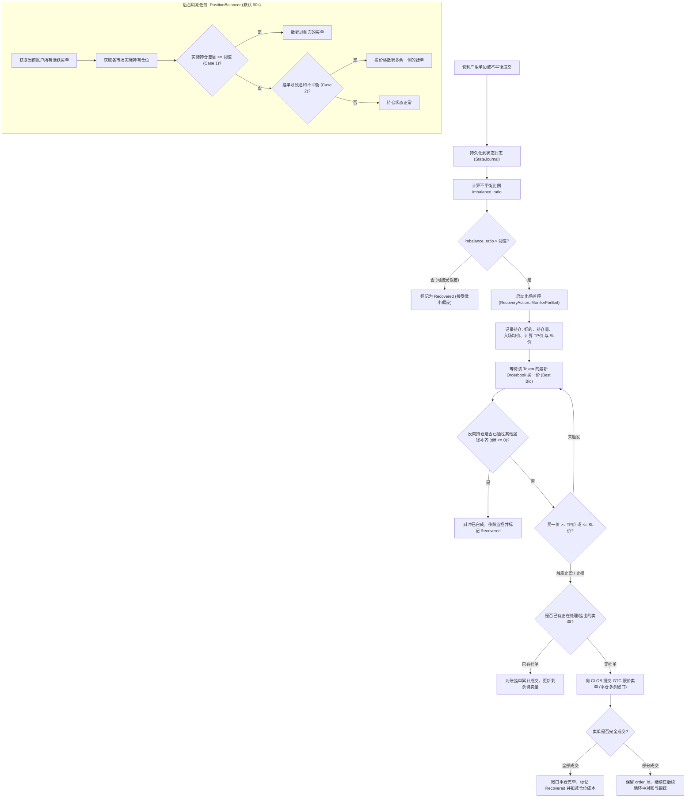
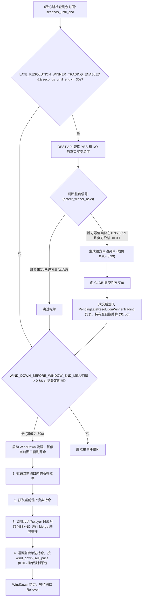

# Polymarket 5-Minute Bot 策略逻辑流程图与架构设计文档

本文档详细描述了 Polymarket 5 分钟预测市场套利机器人的整体策略逻辑、执行路径与状态机转移流程。

---

## 目录
- [一、系统主事件循环与生命周期](#一系统主事件循环与生命周期)
- [二、核心双腿套利检测与执行流](#二核心双腿套利检测与执行流)
- [三、风控、持仓平衡与止盈止损（Hedge Monitor）](#三风控持仓平衡与止盈止损hedge-monitor)
- [四、尾盘策略：Late-Resolution Winner Trading 与 Wind-Down](#四尾盘策略late-resolution-winner-trading-与-wind-down)
- [五、关键代码模块映射表](#五关键代码模块映射表)

---

## 一、系统主事件循环与生命周期

展示系统自启动、窗口发现、多路事件调度（`tokio::select!`）到窗口轮转的整体架构。

---

## 二、核心双腿套利检测与执行流

展示从盘口捕捉（[`ArbitrageDetector`](file:///home/lin/Workspace/Polymarket-5min-bot/src/monitor/arbitrage.rs)）、准入过滤（[`OpportunityAdmissionService`](file:///home/lin/Workspace/Polymarket-5min-bot/src/opportunity_admission.rs)）到分步下单（[`TradingExecutor`](file:///home/lin/Workspace/Polymarket-5min-bot/src/trading/executor.rs)）的完整流转。

---

## 三、风控、持仓平衡与止盈止损（Hedge Monitor）

展示当套利产生不平衡成交时，如何进入风险状态机（[`RiskManager`](file:///home/lin/Workspace/Polymarket-5min-bot/src/risk/manager.rs)）、挂单平衡（[`PositionBalancer`](file:///home/lin/Workspace/Polymarket-5min-bot/src/risk/position_balancer.rs)）以及跟踪止盈止损（[`HedgeMonitor`](file:///home/lin/Workspace/Polymarket-5min-bot/src/risk/hedge_monitor.rs)）。

---

## 四、尾盘策略：Late-Resolution Winner Trading 与 Wind-Down

展示窗口临近到期时，**尾盘胜者吃单**（[`late_resolution_winner_trading.rs`](file:///home/lin/Workspace/Polymarket-5min-bot/src/late_resolution_winner_trading.rs)）与**尾盘平仓风控**（[`wind_down_service.rs`](file:///home/lin/Workspace/Polymarket-5min-bot/src/wind_down_service.rs)）的执行路径。

---

## 五、关键代码模块映射表

| 模块名称 | 核心源码路径 | 功能职责说明 |
| :--- | :--- | :--- |
| **主启动与事件循环** | [`src/main.rs`](file:///home/lin/Workspace/Polymarket-5min-bot/src/main.rs) | 负责各子系统组装、WS 多路复用分发及 1s 心跳 |
| **市场调度与窗口会话** | [`src/market/scheduler.rs`](file:///home/lin/Workspace/Polymarket-5min-bot/src/market/scheduler.rs) [`src/window_session.rs`](file:///home/lin/Workspace/Polymarket-5min-bot/src/window_session.rs) | 负责 5 分钟市场周期计算、市场发现及窗口生命周期 |
| **套利检测与准入** | [`src/monitor/arbitrage.rs`](file:///home/lin/Workspace/Polymarket-5min-bot/src/monitor/arbitrage.rs) [`src/opportunity_admission.rs`](file:///home/lin/Workspace/Polymarket-5min-bot/src/opportunity_admission.rs) | 计算 YES+NO 盘口利润、流动性深度及安全准入检查 |
| **交易报价与两腿执行** | [`src/trading/executor.rs`](file:///home/lin/Workspace/Polymarket-5min-bot/src/trading/executor.rs) [`src/strategy_service.rs`](file:///home/lin/Workspace/Polymarket-5min-bot/src/strategy_service.rs) | 报价计算（滑点/Tick）、较薄腿优先执行及对冲两腿下单 |
| **持仓追踪与风险状态机** | [`src/risk/manager.rs`](file:///home/lin/Workspace/Polymarket-5min-bot/src/risk/manager.rs) [`src/risk/positions.rs`](file:///home/lin/Workspace/Polymarket-5min-bot/src/risk/positions.rs) | 管理总持仓敞口（Exposure）、订单对状态及日志持久化 |
| **不平衡平衡器** | [`src/risk/position_balancer.rs`](file:///home/lin/Workspace/Polymarket-5min-bot/src/risk/position_balancer.rs) | 定期比对各市场多空挂单与持仓，撤除不平衡买单 |
| **动态止盈止损监控** | [`src/risk/hedge_monitor.rs`](file:///home/lin/Workspace/Polymarket-5min-bot/src/risk/hedge_monitor.rs) | 实时监听行情买一价，对单边持仓执行 TP/SL 限价卖出 |
| **尾盘胜方单边吃单** | [`src/late_resolution_winner_trading.rs`](file:///home/lin/Workspace/Polymarket-5min-bot/src/late_resolution_winner_trading.rs) | 窗口尾声（最后 30s）检测胜负并买入胜方持有至结算 |
| **尾盘风控与清仓** | [`src/wind_down_service.rs`](file:///home/lin/Workspace/Polymarket-5min-bot/src/wind_down_service.rs) [`src/merge.rs`](file:///home/lin/Workspace/Polymarket-5min-bot/src/merge.rs) | 窗口结束前撤单、链上对冲 Merge 及兜底平仓 |
