# Polymarket 5-min Arbitrage Bot — 整体架构图

```mermaid
flowchart TB
    subgraph EXT["外部系统"]
        PM_CLOB["Polymarket CLOB<br/>REST + WebSocket"]
        PM_GAMMA["Polymarket Gamma<br/>市场数据 API"]
        POLYGON["Polygon 链<br/>RPC + 代理合约"]
    end

    subgraph ENTRY["启动 / 入口层"]
        MAIN["main.rs<br/>主入口 + 窗口主循环"]
        CFG["config.rs<br/>环境变量配置"]
        LOG["utils/logger.rs<br/>日志 / TUI 开关"]
        LS["live_safety.rs<br/>Canary 安全闸"]
        OBS["observability_server.rs<br/>健康检查 HTTP"]
        MET["runtime_metrics.rs<br/>运行指标"]
    end

    subgraph MARKET["市场层 market/"]
        DISC["MarketDiscoverer<br/>5 分钟窗口市场发现"]
        SCHED["MarketScheduler<br/>市场刷新调度"]
    end

    subgraph MONITOR["监控层 monitor/"]
        OB["OrderBookMonitor<br/>订单簿订阅 / YES-NO 配对"]
        ARB["arbitrage.rs<br/>套利机会检测"]
        SG["strategy_gate.rs<br/>快照新鲜度 / 重复信号守卫"]
    end

    subgraph ORCH["策略编排层"]
        SS["StrategyService<br/>下单编排"]
        WSR["WindowSessionRunner<br/>配对→tick（含套利判定）"]
        WS["WindowSession<br/>窗口状态 / 任务归属"]
        WEL["window_event_loop.rs<br/>事件循环退出原因"]
        WD["WindDownService<br/>窗口收尾 / 清仓"]
        CS["connection_supervisor.rs<br/>连接健康 / 退避重连"]
    end

    subgraph TRADE["交易层 trading/"]
        EXEC["TradingExecutor<br/>报价 / 下单 / 执行策略"]
        CLOB["clob_client.rs<br/>CLOB V2 认证客户端"]
        GW["clob_gateway.rs<br/>订单状态读取 / 网关"]
    end

    subgraph RISK["风控层 risk/"]
        RM["RiskManager<br/>状态对账 / 事件观察"]
        POS["positions.rs PositionTracker<br/>敞口计算 / 预留"]
        HM["HedgeMonitor<br/>恢复监控 / 对冲"]
        PB["PositionBalancer<br/>仓位平衡 / 超额撤单"]
        REC["recovery.rs<br/>恢复动作"]
        JRNL["state_journal.rs<br/>崩溃审计日志"]
        OO["owned_orders.rs<br/>订单归属追踪"]
    end

    subgraph PROTO["底层协议 polypulse (lib)"]
        CLOBV2["clob_v2.rs<br/>认证 / 派生 API key"]
        RELAY["proxy_relay.rs<br/>代理钱包 / 合并适配器"]
        DEP["deposit_wallet_relay.rs<br/>存款钱包中继"]
        PUSD["pusd_wrap.rs<br/>pUSD 包装"]
        MERGE["merge.rs<br/>YES+NO 合并"]
        REDEEM["redeem.rs<br/>赎回"]
    end

    subgraph UI["UI 层 ui/"]
        DASH["Dashboard<br/>ratatui 全屏终端"]
    end

    %% ===== 启动与认证 =====
    CFG --> MAIN
    LOG --> MAIN
    MAIN --> DISC
    MAIN --> CLOB
    CLOB --> CLOBV2
    CLOBV2 --> PM_CLOB
    MAIN --> RM
    MAIN --> HM
    MAIN --> SS
    MAIN --> LS

    %% ===== 市场发现 =====
    DISC --> PM_GAMMA
    SCHED --> DISC

    %% ===== 主循环数据流 =====
    SCHED -->|"get_markets<br/>immediately_or_wait"| OB
    OB -->|"subscribe_market"| PM_CLOB
    OB -->|"handle_book_update<br/>→ pair"| WSR
    WSR -->|"process_pair"| SG
    SG --> WSR
    WSR -->|"tick.opportunity"| EXEC
    EXEC -->|"execution_quote<br/>/ 下单"| CLOB
    CLOB --> PM_CLOB

    %% ===== 执行前守卫链 =====
    EXEC --> POS
    EXEC --> PB
    EXEC --> LS
    EXEC -->|"execute()"| SS

    %% ===== 风控 =====
    RM --> POS
    RM --> JRNL
    RM --> OO
    HM --> REC
    HM --> JRNL
    HM --> POS
    PB -->|"cancel excess<br/>orders"| CLOB
    RM -->|"observe_order_event<br/>用户订单流"| PM_CLOB

    %% ===== 窗口生命周期 =====
    WS --> WD
    WD -->|"清仓 / 合并"| MERGE
    WS --> WEL
    CS -->|"用户订单流<br/>auth WS"| PM_CLOB

    %% ===== 后台任务 =====
    MERGE --> POLYGON
    REDEEM --> POLYGON
    RELAY --> POLYGON
    PUSD --> POLYGON
    DEP --> POLYGON

    %% ===== 指标 / 观测 =====
    SS --> MET
    MET --> DASH
    MAIN --> OBS
    MAIN --> DASH
```



## 分层说明

| 层 | 模块 | 职责 |
|---|---|---|
| 启动/入口 | `main.rs` 等 | 配置加载、TLS、CLOB 认证、组件装配、窗口主循环 |
| 市场层 | `market/` | 按 5 分钟窗口发现并调度市场列表 |
| 监控层 | `monitor/` + `strategy_gate.rs` | 订阅订单簿、YES/NO 配对、套利检测、预交易守卫 |
| 策略编排 | `strategy_service.rs`、`window_session*`、`wind_down_service.rs` | 窗口状态管理、配对处理、收尾清仓 |
| 交易层 | `trading/` | 报价、下单、订单状态读取（CLOB V2） |
| 风控层 | `risk/` | 敞口限制、仓位预留、恢复监控、仓位平衡、崩溃审计 |
| 底层协议 | `polypulse` lib | CLOB 认证、代理中继、pUSD 包装、合并、赎回（链上） |
| UI | `ui/` | ratatui 全屏仪表盘 |

## 核心数据流（一次套利）

```
订单簿流 → OrderBookMonitor.handle_book_update → WindowSessionRunner.process_pair
  → strategy_gate 校验 → tick.opportunity
  → TradingExecutor.execution_quote（滑点/费率修正报价）
  → PositionTracker.reserve（敞口预留） → PositionBalancer.should_skip（平衡检查）
  → live_safety.try_start_pair（Canary 闸门） → StrategyService.execute（下单）
```
