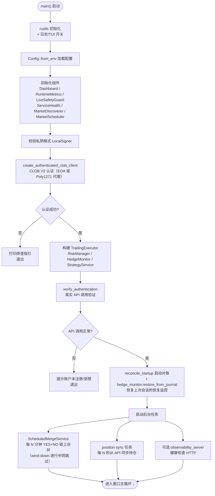
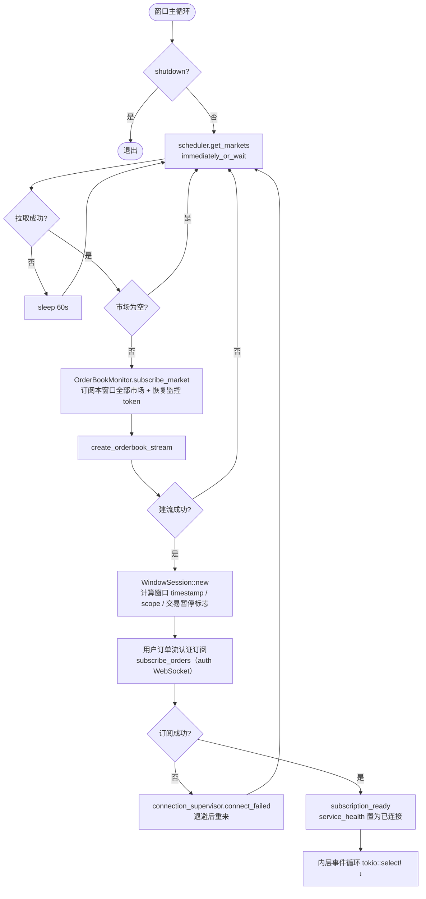
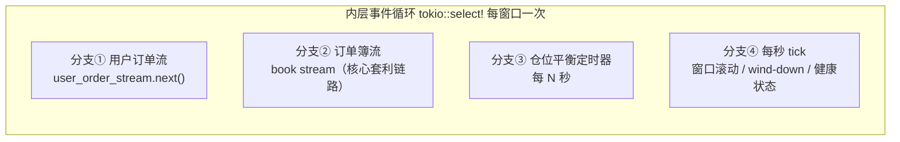
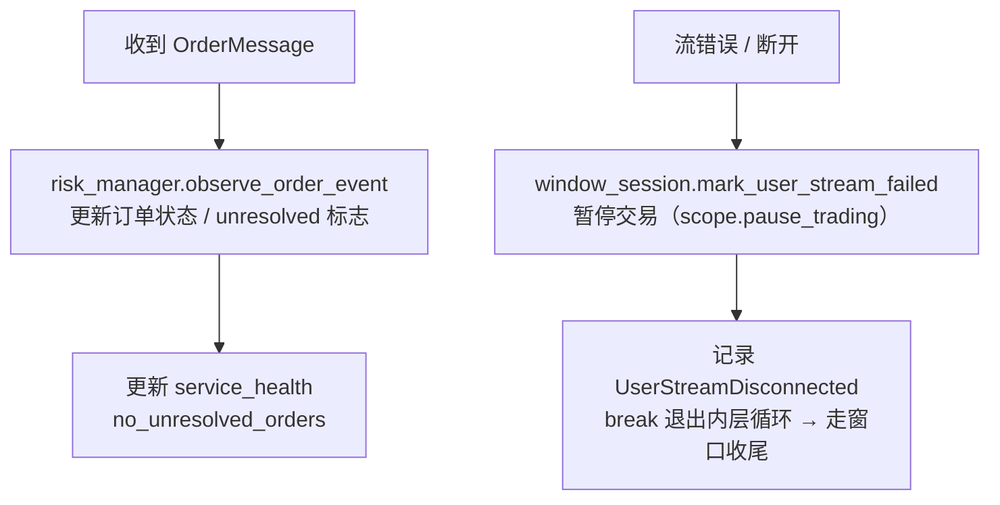
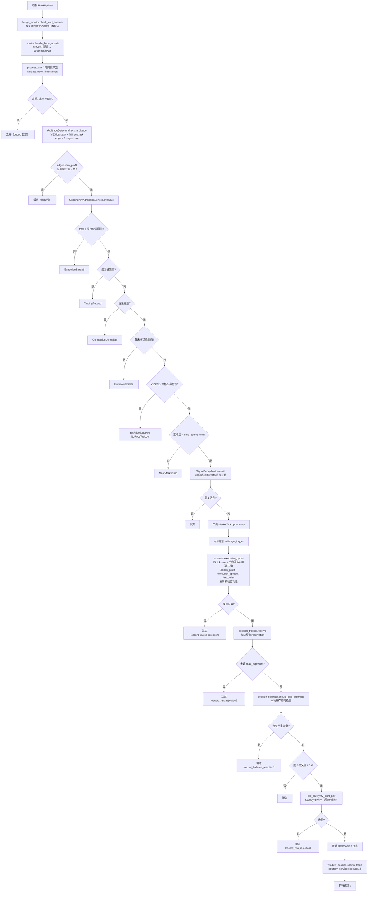
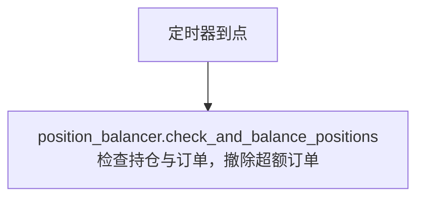
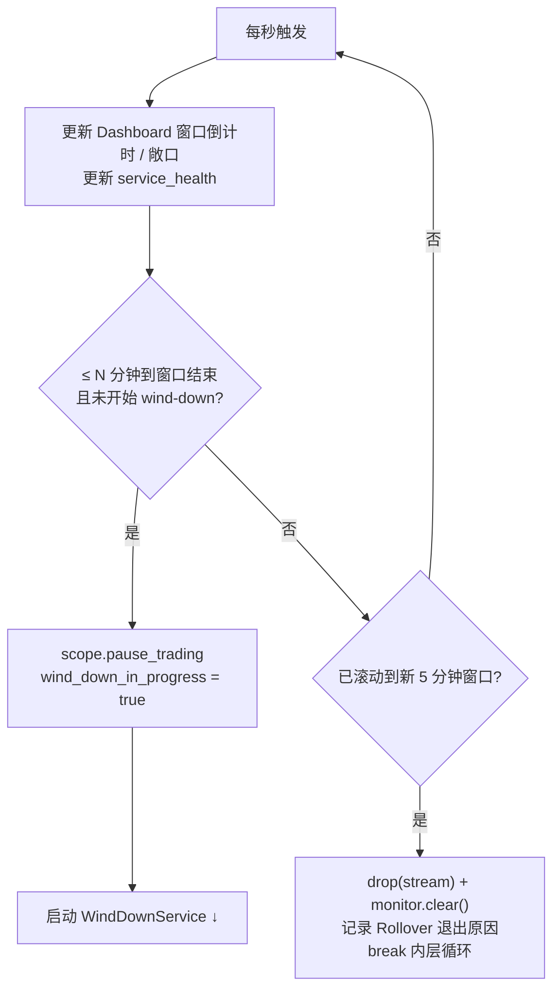
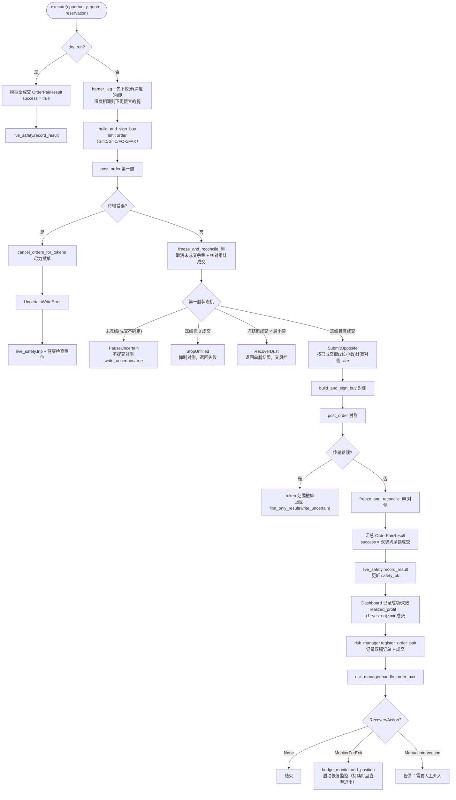
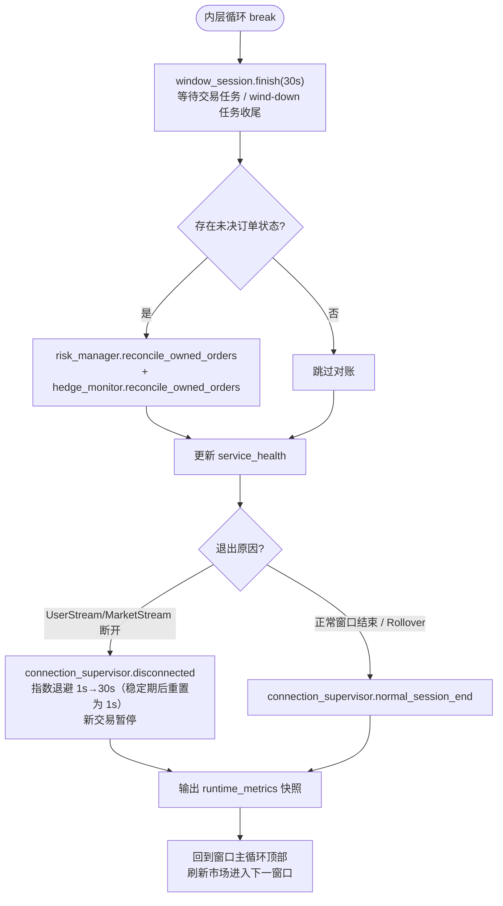
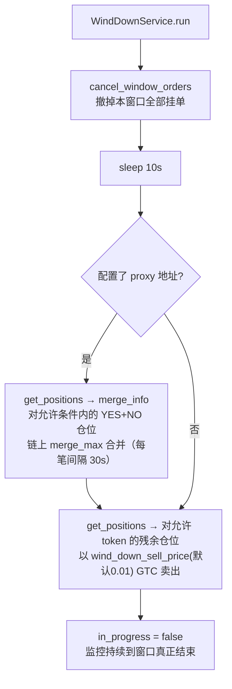

# 主循环业务流程图（完整链路）

## 一、启动阶段（一次性）

## 二、窗口主循环（每个 5 分钟窗口）

### 内层事件循环的四个分支

**分支① 用户订单流**：

**分支② 订单簿流（核心套利链路）**：

**分支③ 仓位平衡**：

**分支④ 每秒 tick**：

## 三、下单执行链路（StrategyService.execute）

## 四、窗口收尾与 wind-down

**WindDownService 内部流程**（窗口结束前触发）：

## 关键状态与闸门汇总

| 阶段 | 守卫/闸门 | 作用 |
|---|---|---|
| process_pair 前 | `validate_book_timestamps` | 快照新鲜度 / 未来时间 / YES-NO 偏斜 |
| 检测 | `ArbitrageDetector` | edge ≥ min_profit、单腿 ≥ $1 |
| 准入 | `OpportunityAdmissionService` | 价差阈值、暂停、连接健康、未决状态、最低价、临近收盘（6 类拒绝） |
| 去重 | `SignalDeduplicator` | 冷却期内相同价格信号 |
| 报价 | `calculate_execution_quote` | tick 向上取整、方向滑点、利润+费率缓冲 |
| 敞口 | `PositionTracker.reserve` | 总敞口 ≤ max_exposure |
| 平衡 | `PositionBalancer` | 持仓严重失衡时跳过 |
| 节流 | 3s 最小交易间隔 | 防止并发刷单 |
| 安全 | `LiveSafetyGuard.try_start_pair` | Canary 限额 / 累计亏损 / 对数上限 |
| 执行中 | 第一腿状态机 | 传输错误→不追加对侧；未冻结→暂停；0 成交→停止 |
| 事后 | `handle_order_pair` | 单腿成交→恢复监控；不确定写→trip |
